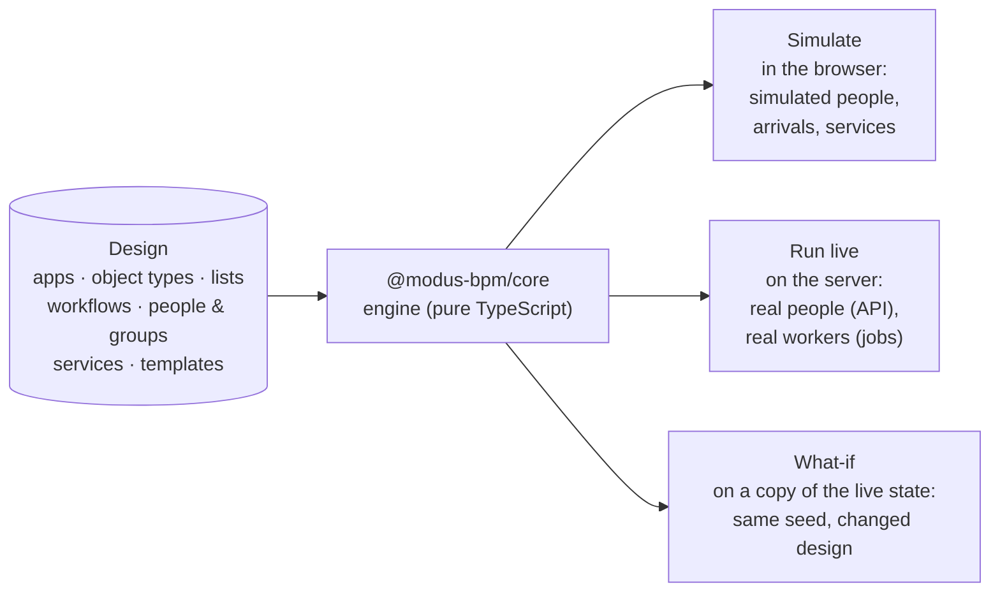
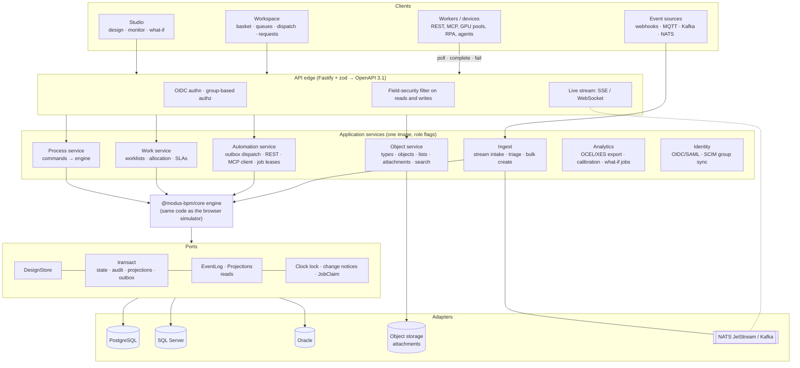
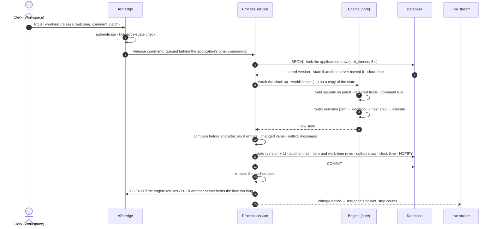
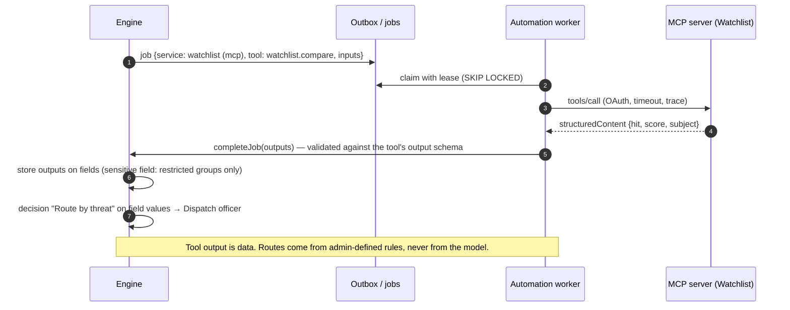

# Architecture

Modus has one idea at its center: **the model is the system**. The process an
administrator draws is the thing that runs, the thing that is simulated, and the thing
that is monitored. There is no second copy that can drift.



The same engine code powers all three. A simulated run is a forecast using production
semantics; a what-if experiment is the live state run forward with a change; and the
production server is the simulator with the simulated parts switched off.

- [Repository layout](#repository-layout)
- [Domain model](#domain-model)
- [Engine semantics](#engine-semantics)
- [Search and the assistant](#search-and-the-assistant)
- [Roles and supervision](#roles-and-supervision)
- [Call stack (target)](#call-stack-target)
- [Request sequences](#request-sequences)
- [Persistence and database strategy](#persistence-and-database-strategy)
- [Technology choices](#technology-choices)
- [Security model](#security-model)
- [Deployment](#deployment)
- [From prototype to production: milestones](#from-prototype-to-production-milestones)
- [Decisions and alternatives](#decisions-and-alternatives)

The complete stack, layer by layer, is in [TECH-STACK.md](TECH-STACK.md); running it (Docker,
Compose, Helm, configuration) is in [DEPLOYMENT.md](DEPLOYMENT.md). Background research:
[competitive analysis](research/competitive-analysis.md) and
[backend options](research/backend-options.md) (engines, databases, libraries, deployment).

## Repository layout

```
packages/core     the model and the engine — no UI, no I/O, deterministic
  src/model       design-time types, rules, field security, templates, sample data
  src/engine      tokens, routing, distribution, services, admin + workspace operations,
                  read models (counts, baskets, queues), what-if scenarios, tests
apps/studio       React app: Studio (design + administer) and Workspace (do the work)
apps/server       the engine live behind a REST API, worker job protocol, live stream,
                  search, assistant, supervision; serves the built studio
templates         the starter library: fifty template files, the format the Studio exports and imports
deploy/helm       Helm chart (Dockerfile and docker-compose.yml at the root)
docs              architecture, tech stack, deployment, concepts, roadmap, demo, research
```

Status today: `core` and `studio` are a complete, browser-only prototype (designs saved in
the browser; work simulated). `server` is a working skeleton with in-memory storage, used to
prove the call stack and the worker protocol end to end; it ships as one container image that
also serves the studio.

## Domain model

### Design time (what administrators build)

| Concept | What it is |
| --- | --- |
| **Application** | A bundle of object types, lists and workflows (e.g. Invoice Processing). |
| **Object type** | A dynamically defined record: fields (text, number, currency, date, yes/no, choice, person, email, attachment, and **tables** of rows such as invoice line items), numbering, title, priority field, permissions per group, and *sensitive* fields visible only to some groups. Forms are generated from it. |
| **Table field** | Multi-row data inside an item: typed columns, formula columns (`Quantity × Unit Price`), row limits, and **total fields** that sum a column. Calculated values are kept by the engine and are read-only everywhere. |
| **Form design** | How an object type's form looks: sections of one to four columns, each with a look of its own (plain, card, tinted, outlined, an accent colour, a title size), fields at a chosen width with their own label and guidance, headings, paragraphs, callouts, dividers, space and pictures between them, and choices for the whole form (how wide, labels above or beside, spacing). Made in the forms designer, where the canvas is the form drawn by the code the Workspace uses. Without one, the form is every field in order. It only arranges: field security still decides who sees and changes what, and a field the layout leaves out is still shown at the end. |
| **Look** | How the Workspace is drawn for the people working in it: a name and logo, four colours every other shade is mixed from, typeface, corners, room, how fields and labels are drawn, the side panel, and style rules of the organization's own. Set for the organization; an application can differ. |
| **List** | Flat or linked (cascading) reference data: Model Year → Make → Model. |
| **Workflow** | A graph of steps and paths for one object type. `process` workflows start when an item is created; `subflow` workflows run inside a subflow step. Has a target time (due dates), workflow-wide field locks, **process supervisors**, and an **expedite policy** (who may expedite, how much faster, whether a reason is required). |
| **Step types** | Start (form, API, event stream, schedule, inbox) · User step · Automated step · Decision · Parallel split · Join · Subflow · Timer · End. |
| **People & groups** | Users (speed and availability for simulation; organization **roles**: administrator, designer, auditor), team groups (do the work, with a supervisor) and distribution groups (dispatchers who hand work out). People steps can name **task supervisors**. |
| **Service registry** | Every system automated steps can call: REST/OpenAPI, MCP servers, worker pools (registered services), AI agents, email. Each has operations with typed outputs, a capacity, a status and a credential *reference* (never the secret). |
| **Template** | A reusable subflow with the fields it needs; stamped into any application with a field mapping. |

### Run time (what the engine tracks)

| Concept | What it is |
| --- | --- |
| **Item** (`SimObject`) | One business object moving through a process: its data (including line items), priority, an optional **expedite** flag (who, when, why), due date, status and complete history. |
| **Token** | One thread of execution. An item has one token per active parallel branch. A token at a people step *is* a work item. |
| **Fork / call frames** | A token's stack of the splits it is inside (so a join knows which branches belong together) and the subflows it is running in (so it can return). |
| **Audit entry** | Every routing decision, assignment, release, field change, service call, split, join, escalation and security refusal, with who and when. This is the event log. |

## Engine semantics

The engine is deliberately smaller than full BPMN 2.0 and explicit about the behaviors
business processes actually need. Each maps to a standard concept (see
[CONCEPTS.md](CONCEPTS.md)).

- **Routing.** A decision checks its branches top to bottom against the item's field values;
  the first match wins, with an "Otherwise" path. A user step routes on the outcome the person
  chose. An automated step routes on *Succeeded* / *Failed*. A subflow step routes on the name
  of the ending its subflow reached.
- **Parallel split** runs every path (`all`) or every path whose rule matches (`inclusive`).
  Each branch carries a fork frame.
- **Join** pairs with the innermost fork frame and continues when *all* branches arrived, the
  *first* one arrived, or *N of M* arrived; optionally it withdraws the branches still running.
  Branches that end elsewhere stop being waited for. A rejection in any branch ends the whole
  item (or the whole subflow) and withdraws its siblings.
- **Subflows** push a call frame, run the child workflow on the same item, and pop it at an
  end step. A rejected or cancelled ending with no path out ends the caller the same way.
- **Automated steps** call a registered service. Capacity limits calls in flight (the rest
  queue — automated steps can be bottlenecks too); failures retry, then follow the step's
  policy: take the *Failed* path, hand the work to a person in a fallback group, or stop for an
  administrator. An administrator can take work off an automated step and give it to a person.
- **Distribution** at people steps: load balanced (fewest open items, round robin on ties),
  queue (people claim or "get next", most urgent first), distribution group (dispatchers hand
  each item to someone), direct, and from a field on the item (retain familiar). Escalation
  raises priority, notifies, and/or returns work to the dispatchers after N hours.
- **Field security** has three layers and the strictest wins: sensitive fields restricted to
  groups (object type) → workflow locks (always, or after a step) → step access
  (edit/read/hidden). The engine refuses locked changes and audits the attempt; the forms
  show the same answer.
- **Line items.** Table fields hold rows with stable ids. Every write (form, API, automated
  step) runs `normalizeData`: formula columns and total fields are recalculated, and a person can
  never type over them. Rules can count rows, sum/min/max a column, or test *any row* / *every row*
  ("any line where Category is Software"). A table is one field for security; if its total is
  locked, the table locks with it.
- **Work attributes in rules.** Besides fields, rules can test the item's **work priority** and
  whether it is **expedited** — e.g. an expedited invoice under $5,000 takes a fast lane.
- **Expedite.** An expedited item ranks above Urgent in every queue, basket and dispatch board;
  its step service levels, target time and escalation thresholds shrink by the policy's factor.
  The flag is audited with who and why, and the policy decides who may set it.
- **Supervision.** A step's supervisors are its named task supervisors, its work group's
  supervisor, and the process supervisors of every workflow in its call stack. Supervisors can
  reassign within the group, return, release on behalf, retry, set priority, expedite and
  redistribute; escalations can notify them.
- **Determinism.** Randomness only comes from a seeded generator stored in the state, so a run
  repeats exactly, a what-if scenario differs from its baseline only by its change, and state
  can be cloned, saved and replayed.
- **Model-driven, with versions.** The engine reads the design on every call. A workflow's map
  is its **draft**; publishing copies it into a numbered **version**, and new items start on
  the published one. Each item **pins** the version it started on (and each subflow's version
  when it first enters it) and runs it to the end: every lookup for a specific item — routing,
  allocation, timers, escalations, service calls, joins, field security, worklists — goes
  through that item's own index (`indexFor`, cached per set of pins). A publish can also
  **migrate** the items in flight (`migrateItems`): work at a step both versions have stays
  put, work at a removed step moves where the administrator maps it (re-allocated like a move)
  or the item stays on its version with the reason, and the move is audited. Work parked at a
  broken spot resumes once it runs a version that fixes it. A workflow without versions runs
  its map directly, as every workflow once did (the server's designs today).
- **Access across versions.** Who may see and supervise an item is the *stricter* of the version
  it runs and the live version: a process or task supervisor must hold in both (at a step the
  live version dropped, only the live process supervisors qualify), field access is computed
  under both and the strictest wins per field (hidden over read over edit), and the expedite
  policy is the stricter of the two. So removing a supervisor or adding a lock reaches items in
  flight at once, while adding a supervisor reaches only new work. Drafts grant and revoke
  nothing until published. Who *works* a step (its group, dispatchers) stays with the item's
  version, so work in flight always has someone to do it.

### Simulation vs live

`advance(sim, ctx, minutes)` moves the clock minute by minute through: arrivals → timers and
escalations → automated calls finishing → people finishing → retrying stuck work → distributing
→ people picking up work. With `ctx.live = true` (the server), arrivals, simulated people and
simulated dispatchers are switched off and service calls become **jobs**:

| | Simulation (studio) | Live (server) |
| --- | --- | --- |
| New items | Poisson arrivals per workflow | API, event streams, schedules |
| People | Simulated speed, outcome weights | Real people via the Workspace / API |
| Dispatchers | Simulated every N minutes | Real dispatchers |
| Service calls | Simulated latency, success rate, outputs | `pollJobs` → worker → `completeJob` / `failJob` |
| Clock | Fast, jumpable | Wall clock (or scaled for demos) |

## Search and the assistant

One query language (`acme "net 30" is:overdue priority:urgent amount>10k step:"manager approval"`)
serves the Workspace search box, the assistant and the API. The core parses it once
(`parseQuery`); each backend compiles it.

- **In the engine** (`searchItems`): an in-memory index over number, title, every field,
  line-item cells and comments, with ranking, snippets and facets. It powers the browser
  prototype and small installs.
- **On the server**: Postgres full-text search (`tsvector`, weighted) with `pg_trgm` for typos and
  prefixes, the typed field and row indexes for filters, optional `pgvector` for "similar items",
  and optional OpenSearch for very large tenants. SQL Server Full-Text Search and Oracle Text
  for those databases.
- **Security inside the index**: ordinary fields and *sensitive* fields go into separate search
  documents, and a person's query only touches the documents they may read; fields hidden by a
  workflow lock leave the index when the lock applies. Item visibility (type read permission,
  creator, holder, supervisor, administrator, auditor) is a predicate in the same query.

**Ask Modus** answers questions in plain words. The built-in tier (`ask`, `translateQuestion`)
runs everywhere, offline: it turns a question into the query language, runs it, and shows the
query so people can trust and learn it; it also answers "how do I…" and "where is the
bottleneck?". On the server, when a model is configured, Claude answers with **tool use**: the
tools (`search_items`, `get_item`, `my_work`, `process_overview`, `explain`) call the core as the
person asking, so the model sees exactly what that person could see. The assistant is read-only;
anything it suggests doing is a button the person confirms. Details and providers:
[TECH-STACK.md › Ask Modus](TECH-STACK.md#ask-modus-the-assistant).

## Roles and supervision

| Model | Covers |
| --- | --- |
| Roles (RBAC) | Administrator (all work, all settings), Designer (change designs), Auditor (read everything). |
| Relationships (ReBAC) | Holder, delegate, dispatcher, **task supervisor** (named on a step, or the group's supervisor), **process supervisor** (named on a workflow, covering its subflows). |
| Attributes (ABAC) | Field security: sensitive fields → workflow locks → step access. |

All of it is pure functions in the core (`hasRole`, `supervisesStep`, `supervisesProcess`,
`canSuperviseToken`, `fieldVerdicts`), used by the browser to show the right controls and by the
server to enforce them. The Workspace's **Supervise** page lists every supervised step with its
work, load and escalations.

## Call stack (target)



What exists today in `apps/server`: the edge (REST + SSE, zod validation, sign-in as a setting:
the `x-user-id` header, a shared password, or OIDC; see `auth.ts`), a runtime that runs every command in one storage transaction, the worker job
protocol, and storage ports with two adapters: in memory (JSON snapshots) and PostgreSQL.

### One transaction per command (M2)

Every change to an application goes through `Storage.transact`. On PostgreSQL:

1. The runtime queues the command behind the application's other commands in this process.
2. The transaction locks the application's `app_state` row (`lock_timeout` 5 s; past that the
   command fails with `503` and "busy"). `statement_timeout` 30 s and
   `idle_in_transaction_session_timeout` 15 s keep a stalled server from holding the row. If
   another server committed since this one's cached version, what it changed comes back with
   the lock: the rest of the state and the items written since, applied to the cached state.
3. The runtime catches the clock up from the stored clock time, then runs the command on a copy
   of the state.
4. Pure core functions compare the state before and after: `changesBetween` finds the new audit
   entries and outbox messages (`job.ready` for a service job that became ready, `notify` for
   notifications and escalations), and `changedItems` the items that changed in any way. The
   command ran on `copyState`'s copy, which shares only what the engine never changes in place,
   so comparing the copied levels by `===` is enough.
5. One commit writes the rest of the state (`app_state`, version + 1), each changed item's
   `item` row (its state beside its projection, at the new version) and `work_item` rows, the
   audit entries, the outbox rows, the clock time, and a `NOTIFY` with the version and the
   changed item ids (when they fit). Items are never removed, so an item's position in the
   state (`item.ord`) is fixed and loading in that order rebuilds the same state.
6. Only then does the runtime replace its cached state. A failed command or commit leaves the
   cache as it was.

Reads answer from the cached state at once, without waiting for queued commands: they see every
command that finished before them, and none still running. A cached state is never changed in
place, so the view the live streams, the overview and the Monitor show is computed once per
committed state and shared.

Storage numbers the audit entries: each item's new entries follow the highest `seq` already
stored for it, under the row lock. The runtime never tracks log positions.

Other servers `LISTEN` on the same channel and, when a notice carries a newer version, load
what changed since their cached one: the rest of the state and the items written since. A dropped listening connection makes `/api/ready` answer 503 until it is back,
and a reconnect reloads every application. One server per application moves the clock: the one
holding that application's advisory lock. A clock tick that changed no item and comes under 30 s
after the stored clock time rolls back, so a quiet application doesn't write every second.
Worker polls read the cache first and skip applications with no open job for that service.

Locking is per application: one command at a time per application across all servers. The
engine still works on a whole application's state, so per-item locking waits for the engine
split in M1. Every server runs an outbox sender: it fans each message out to the configured
webhook endpoints, claims due deliveries with `FOR UPDATE SKIP LOCKED` and a 60-second lease, posts
them signed outside any transaction and records the result, with retries for 24 hours
([DEPLOYMENT.md](DEPLOYMENT.md#webhooks)). Email from Modus and the REST and MCP connectors come in M4.

The memory adapter implements the same contract for one process. On disk each application's
state is a log, one line per commit with the rest of the state and the items it changed,
rewritten as one full line now and then.

### API surface (v0, implemented in the skeleton)

| Area | Endpoints |
| --- | --- |
| Discovery | `GET /api`, `GET /api/health`, `GET /api/ready`, `GET /api/apps`, `GET /api/apps/:app/overview` |
| Process mining | `GET /api/apps/:app/export/ocel` (OCEL 2.0 JSON of the event log; administrators and auditors, without the fields hidden from them) |
| Items | `POST /api/apps/:app/items`, `GET /api/apps/:app/items/:id` (field-security filtered) |
| My work | `GET …/my/basket`, `…/my/queues`, `…/my/distribution`, `…/my/requests`, `POST …/my/next`, `POST …/my/distribution/:step/evenly` |
| Designing | `PUT /api/design` `{revision, design}` (save: workflow maps as drafts, the rest at once), `POST …/workflows/:wf/publish` `{revision, note, who, stepMap}`, `GET …/workflows/:wf/items` (items in flight by version and step), `POST …/workflows/:wf/migrate`, `POST …/workflows/:wf/forecast` |
| Workspace | `GET …/workspace` (one person's share of the state, as they may see it), `…/workspace/items?ids=&pin=`, `…/workspace/search?q=`, `POST …/workspace/ask` |
| Work items | `POST …/work/:id/claim · start · save · release · return · delegate · distribute` |
| Administration | `POST …/admin/work/:id/assign · move · retry` (administrators and supervisors of that work) |
| Search and assistant | `GET …/search?q=`, `POST …/assistant` (Claude with tools when configured; built-in otherwise) |
| Supervision | `GET …/my/supervision`, `POST …/supervise/:id/assign · return · release · retry`, `POST …/supervise/steps/:step/redistribute`, `POST …/supervise/items/:id/priority` |
| Expedite and priority | `POST …/items/:id/expedite {on, reason}` (checked against the process's policy), `POST …/items/:id/priority {priority}` (the requester, or whoever is working it) |
| Files | `POST …/files?name=&kind=` (the bytes as `application/octet-stream`; answers what to put in the item's data), `GET …/items/:id/files/:fileId` (for whoever may read that field of that item), `GET …/files/:fileId` (its uploader, until an item has it) |
| Workers | `POST /api/jobs/poll`, `POST /api/jobs/:id/complete`, `POST /api/jobs/:id/fail` (the service's listed workers and administrators) |
| Live | `GET /api/apps/:app/stream` (Server-Sent Events, below; any named user) |
| Design | `GET /api/design` (the design with its `revision`, services without connection details; drafts only for designers and administrators) |
| Monitor | `GET …/monitor`, `…/monitor/series`, `…/monitor/feed`, `…/monitor/items` (administrators) |

The live stream sends `event: change` with `{clock, items, counts, active}`, where `items` lists the
changed item ids. While a client is behind (its buffer is full) the server holds the changed ids
and sends them as one merged event, with the counts as of then, when it catches up. `items: null`
means too much changed meanwhile (over 1,000 items): refetch everything. `: ping` comments keep a
quiet stream open through proxies. Like the design, the stream is for any named user (`x-user-id`,
401 without one): it carries ids and counts, never item data.

### The Studio on a server: the Monitor (M3, first slice)

Served by a Modus server, the Studio's Monitor reads the server instead of simulating. At startup
the Studio asks `GET /api/health`; an answer means a server serves it, and the Monitor header shows
**Live / Simulation**, opening on Live. Live draws the server's published design (`GET /api/design`)
and fills every panel from the administrator-only reads: `/monitor` (KPIs, steps, services,
workload with what each person is working on), `/monitor/series` (work in flight over time,
incremental), `/monitor/feed` (activity) and `/monitor/items` (the item explorer, paged, sharing the
core's search cache per app). The `stream` keeps step counts current from each `change` event;
the other panels refetch at most once a second, and not at all while the tab is hidden. Simulation is the in-browser simulation as before,
including what-if. Where the server signs people in (`MODUS_AUTH=oidc`) the Studio is whoever signed in. Otherwise it
sends `x-user-id` as an administrator (the sample's, or one picked from the design), which the
server takes at its word: don't expose a server with `MODUS_AUTH=none`. The Monitor is read-only on the server for now. The standalone build
(Pages, `pnpm dev`) has no server and is unchanged.

### The Studio on a server: the Workspace (M3)

Served by a Modus server with Live chosen, the Workspace works the server's real work. Every page
reads what the server sent and every action is a request to the API; nothing is simulated behind
it. The same **Live / Simulation** switch sits in the Workspace's sidebar, and Simulation is the
in-browser simulation as before.

The pages are the ones the simulation uses, unchanged. They need an engine state to run the read
models over (`basketOf`, `queuesFor`, `distributionFor`, `requestsBy`, `supervisionFor`), so the
server sends each person their share of the state rather than ready-made lists:

- **`GET …/workspace`** returns the items in the caller's Workspace (core's `workspaceSlice`):
  active items with work in their basket, in a queue they fetch from, at a step they hand work
  out for or at a people step they supervise, and the requests they made (finished ones newest
  first, up to 200). A test runs every person of every sample application through the read
  models over the slice and over the whole state and expects the same lists.
- **Field security is applied on the server** (core's `workspaceItem`). An item's data is built
  from its type's fields, leaving out those hidden from the caller, and history lines that show a
  hidden field read their redacted text. Someone who meets an item only in a worklist and may not
  read it otherwise gets a row's worth: number, title, priority, due date and where its work is.
  No other data, no history, no expedite reason. Workload counts (`loads`, for the delegate, hand
  out and reassign pickers) cover only the caller's teams and the groups they hand out to or
  supervise.
- **Keeping it current.** The Studio follows `…/stream`. A `change` event names the items that
  changed; the Studio asks `…/workspace/items?ids=` for just those, as the caller may see them
  now, and the answer says which have left their Workspace (`gone`). `items: null`, a dropped
  stream or a tab that was hidden leads to one full reload. Refetches are throttled to one a
  second.
- **Acting.** The Workspace's actions are one list of commands
  (`apps/studio/src/features/workspace/commands.ts`), each with two forms: the engine operation,
  run on the simulation, and the request for the route that runs the same operation on the
  server. After a command the Studio reloads the caller's Workspace before it reports the result,
  so the item they just took is there to open. Refusals (403, 404, 409) come back as the engine's
  own message and show as a warning.
- **Search and Ask Modus** go to the server (`…/workspace/search`, `…/workspace/ask`), which
  searches everything the caller may read, not only their Workspace. Hits carry their items, and
  the Studio keeps them (the newest 200) so a hit can be opened; `pin=` on `…/workspace/items`
  keeps those current for as long as the caller may read them.

On a server that signs people in (`MODUS_AUTH=oidc`) you work as yourself. Otherwise the Workspace
sends `x-user-id` as the person chosen with "Working as", from the server's design. Known limits, left for when a deployment shows they matter: every connected
Workspace asks about every changed item (the stream isn't filtered per person); a command's
reload may be answered by another replica that hasn't heard of it yet, in which case the stream
corrects it a moment later; an administrator's Workspace holds every active item, since they
supervise everything.

### The Studio on a server: designing (M3)

In Live the designer pages edit the design the server runs, and the server stops depending on the
sample after its first start. The design and its decisions are in
[plans/2026-11-10-publish-to-server-design.md](plans/2026-11-10-publish-to-server-design.md); in short:

- **One document with a revision.** Every write of the design makes the next revision. A save
  names the revision it was made from and is refused (409) when the stored one is newer.
- **Save.** `PUT /api/design` takes a workflow's map and settings as its **draft**, which runs
  nothing: the engine runs each workflow's published version, and items keep the version they
  started on. Everything else in the design (object types, lists, people, groups, services, new
  applications and workflows) takes effect at once, so the server refuses a save that would
  strand work or lock people out: removing an application, workflow or object type that has
  items, or a person who holds work; changing a workflow's kind or object type; leaving no
  administrator; changing roles without being one. Versions, which one is published, and
  services' connection details are the server's and a save can't touch them.
- **Publish.** `POST …/workflows/:wf/publish` makes the saved draft the next version. For new
  items only, items in flight finish where they are. For items in flight too (administrators),
  they are moved with the step map, and those that can't move stay and the answer says why. The
  three steps (pin the items in flight, write the version, move the items) run in an order that
  is safe to stop after any of them.
- **Replicas.** A design write tells every server its revision and they reload. A command on a
  server that hasn't heard yet is handed the stored revision by its transaction and reloads the
  design before it runs, so no item runs against a design that lacks its version. Browsers
  hear `event: design` on the stream.
- **The first write of a design stored by an earlier release** gives each workflow a version 1
  made from its map as it stands, so saving a draft never changes what runs.
- **The Studio.** Its design store holds this browser's design (Simulation) or a working copy of
  the server's (Live). Save sends the copy; if someone else saved meanwhile, the designer's
  changes are carried over to the newer design part by part (a workflow, an object type, a list,
  a person, a group, a service) and saved again, asking only about a part both changed. The
  publish dialog, History and the step mapping count the server's items in flight
  (`…/workflows/:wf/items`, which carries versions and steps and no item data), and "Try it
  first" asks the server to run a copy of its live state forward with and without the draft,
  with simulated people and arrivals.

The Studio designs as whoever signed in (`MODUS_AUTH=oidc`), or else as the administrator chosen in
the Monitor. Known limits: the
forecast runs inside the request, so a long horizon on a large state holds the server for a
moment; the stream that announces design changes is open only on the Monitor and the Workspace,
so a designer page learns of someone else's save when it comes back into view or saves; moving
one item from its drawer is still a Simulation feature (History moves items on a server).

## Request sequences

### A person releases a work item



### A parallel split fires and the join waits

```mermaid
sequenceDiagram
  autonumber
  participant E as Engine
  participant A as Branch A (person)
  participant B as Branch B (ERP worker)
  participant C as Branch C (records worker)
  E->>E: split "Pay & file": fork f1 (expect 3), three tokens
  par
    E->>A: work item in a basket
  and
    E->>B: job for svc_erp
  and
    E->>C: job for svc_records
  end
  B-->>E: complete → token waits at join (1/3)
  C-->>E: fail → retry → complete → (2/3)
  A-->>E: release → (3/3): join continues with one token
  Note over E: Each command locks the item, so exactly one<br/>transaction sees "3 of 3"; two branches can never both be last.
```

### An automated step calls an MCP tool and the result routes the item



### High-volume signals (the camera example)

Camera events land on a stream (NATS JetStream with its MQTT listener, or Kafka). Ingest
workers batch them through AI triage with capacity limits; **only events worth a person's
time become items**, created in bulk. In the sample *Video Security Operations* app the AI
step is bound to a two-GPU worker pool, and the simulation shows it becoming the bottleneck at
120 events/hour — the what-if lab shows that a third and fourth GPU worker clear it.

## Persistence and database strategy

The classic approach — generating a table per object type and altering it whenever a field is
added — needs runtime DDL, per-type migrations and DBA change control for every design edit.
EAV (one row per field value) avoids DDL but makes every query a pile of self-joins. Modus
takes the hybrid that modern databases make cheap:

- **Event log + projections, in one transaction.** Every command appends the item's new events
  (the audit trail) and updates current-state projections (item, tokens, work items) in the same
  transaction. Worklists are immediately consistent; history is complete; replay, process mining
  and simulation calibration come from the same log. A per-item hash chain for tamper evidence
  is planned (`prev_hash` below); today the server only appends to the log, and nothing would show
  an edit made directly in the database.
- **Objects as JSON documents.** The item's data is one JSON column validated by its object type
  (which is versioned). **Line items live inside it** as arrays of rows with stable ids, so an item
  stays atomic (one version, one audit entry per change); searchable columns are copied to
  `object_row_idx`, and very large tables (over ~500 rows) move to a paged child table. Fields an administrator marks *searchable* are copied into a narrow,
  typed index table (`object_field_idx`) in the same transaction, with identical DDL on every
  database. Per-type reporting **views** give BI tools tidy columns without copying data.
- **Workflow versions are immutable.** Publishing writes a new `workflow_version` row; the
  editable map is a separate draft. **Each item records the versions it runs**
  (`item_version`), so a published change never shifts the rules under work in flight unless
  an administrator moves it, and every past decision can be explained by the version it ran.
- **Outbox, timers and job claims in tables**, claimed with `FOR UPDATE SKIP LOCKED` (Postgres,
  Oracle) or `UPDLOCK, READPAST` (SQL Server). No extra infrastructure. Delivery is **at least
  once**: a webhook receiver or a worker can see the same message twice, so receivers should treat
  the message `id` as an idempotency key.

The tables below are the target. What is built today is the smaller set described under
[One transaction per command (M2)](#one-transaction-per-command-m2): the design as one document,
the state and its item rows, the event log, the projections and the outbox. In particular there
is no `tenant_id`, no `prev_hash` and no `timer` table yet. Uploaded files are kept in a `file` table,
bytes included (a `storage_key` into object storage, as below, is the plan for large files).

```
object_type(id, tenant_id, key, version, schema_json)
workflow(id, tenant_id, key, name, draft_json, published_version)
workflow_version(workflow_id, version, published_at, published_by, note, snapshot_json)
item_version(item_id, workflow_id, version)    -- the version of each workflow an item runs
object(id, tenant_id, type_id, type_version, number, title, status, priority, due_at,
       data JSON, row_version, created_at, created_by, updated_at, updated_by)
object_field_idx(tenant_id, type_id, field_id, object_id, v_text, v_num, v_date, v_ref)
object_row_idx(tenant_id, type_id, field_id, object_id, row_id, column_id, v_text, v_num, v_date)
object_search(tenant_id, object_id, scope, tsv tsvector, text_trgm, embedding vector NULL)
                                                    -- scope: 'open' or a sensitive-data group
item_event(tenant_id, item_id, seq, event_id, kind, at, actor, step_id, token_id,
           payload JSON, model_version, prev_hash)          -- UNIQUE(item_id, seq)
token(id, item_id, workflow_id, step_id, state, assignee_id, forks JSON, calls JSON, …)
work_item(id, item_id, token_id, step_id, state, assignee_id, group_id, priority,
          urgency_rank, due_at)          -- INDEX (step_id, state, urgency_rank DESC, due_at)
outbox(id, item_id, kind, payload JSON, idempotency_key, status, attempts, next_at)
timer(id, item_id, due_at, kind, payload JSON, status)
list_item(id, list_id, parent_id, label, sort, active)
attachment(id, object_id, field_id, name, size, mime, sha256, storage_key)
```

### Which databases

| Database | Plan | Notes |
| --- | --- | --- |
| **PostgreSQL 16–18** | First, v1.0 | `jsonb`, expression/GIN indexes, `SKIP LOCKED`, `LISTEN/NOTIFY`, row-level security for hosted multi-tenancy. |
| **SQL Server 2022 / 2025** | Certified in v1.x | 2022: `nvarchar(max)` + `ISJSON` + computed columns; 2025: native `json` type and JSON index. Require `READ_COMMITTED_SNAPSHOT ON`. |
| **Oracle 19c / 26ai** | v1.1 | 19c: CLOB + `IS JSON`; 21c+: native `JSON`. Function-based indexes on `JSON_VALUE`. |

All three sit behind the same storage ports and must pass one shared contract test suite
(containers in CI). The SQL layer is Kysely (MSSQL dialect built in; a community Oracle dialect
we would vendor or contribute to). Vendor-specific features (JSON Relational Duality, SQL
Server JSON indexes) are optional accelerations inside an adapter, never design dependencies.
If Oracle/SQL Server parity ever outweighs one language end to end, the ports keep a .NET/EF
Core server tier feasible; see [backend options](research/backend-options.md#3-multi-database-support-in-practice).

## Technology choices

| Layer | Choice | Status |
| --- | --- | --- |
| Engine | Own deterministic TypeScript engine (`@modus-bpm/core`), shared by simulator and server | **Done** (prototype) |
| Studio + Workspace | React 19, Vite, Tailwind CSS 4, React Flow 12, Zustand | **Done** (prototype) |
| API edge | Node.js LTS, Fastify 5, zod 4 → OpenAPI 3.1; SSE for live updates | **Skeleton** |
| Data access | Kysely behind storage ports; contract test suite | **Skeleton** (design, state, event log, projections, outbox; M2) |
| Database | PostgreSQL first; SQL Server, then Oracle | PostgreSQL **done** (M2); SQL Server, Oracle planned (M6, v1.1) |
| Jobs, timers, outbox | Own tables + SKIP LOCKED / READPAST claims | Outbox written (M2) and sent to webhooks, claimed with SKIP LOCKED (**done**); timer claims planned (M3) |
| Automation | REST/OpenAPI connector; MCP client (TypeScript SDK v2, spec 2026-07-28); long-poll worker protocol (gRPC later); JSONata mapping | Protocol **skeleton**; connectors planned (M4) |
| Event ingest | NATS JetStream (incl. MQTT listener); Kafka connector optional | Planned (M5) |
| Identity | Sign-in as a setting: none, a shared password, or OIDC (`openid-client`; tested against Keycloak); machine tokens | **Done** |
| Identity, later | OIDC against Entra ID, Okta, Login.gov; roles and groups from claims; SAML; SCIM 2.0 group sync | Planned (M2–M6) |
| Observability | OpenTelemetry traces across click → command → job → MCP call; Prometheus metrics; structured logs | Planned |
| Process mining | OCEL 2.0 export from the event log (`exportOcel`); XES (IEEE 1849-2023) next | OCEL **done**; XES planned |
| Search | Query language in the core; Postgres FTS + `pg_trgm` + field/row indexes; optional `pgvector`, OpenSearch | In-engine **done**; database-backed planned (M3) |
| Assistant | Built-in interpreter in the core; Claude with tool use on the server (Anthropic API, Bedrock, Vertex, or a local endpoint) | Built-in **done**; model path in the server |
| Attachments | Files uploaded to the server, kept behind a `Files` storage port (PostgreSQL `bytea`, or a directory with the memory store); per-field limits on kind, number and size | **Done**; S3-compatible storage planned |
| Forms and look | A form layout per object type (`formPlan` in the core) and a theme for the Workspace (`themeVars`, `cssProblem`), drawn by the same form renderer in the builder's preview and in the Workspace | **Done** |
| Packaging | One OCI image (server + studio), Docker Compose with Postgres (optional NATS/Keycloak), Helm chart, GHCR images | **Done** |

## Security model

- **Identity**: a setting on the server (`MODUS_AUTH`, see
  [DEPLOYMENT.md](DEPLOYMENT.md#sign-in)). With `oidc` the identity provider says who signed in,
  the server matches that to a person by their sign-in name, and a signed cookie carries it; the
  `x-user-id` header is ignored. `none` and `password` take the header at its word and are for a
  laptop and for demos. Planned: directory groups mapped to Modus groups (claims, then SCIM), SAML.
- **Authorization layers**: organization roles (administrator, designer, auditor); object-type
  permissions (create/read/update/delete per group); who may act on a work item (holder,
  delegate, dispatcher, task or process supervisor, administrator); and field security (sensitive fields → workflow locks → step access). Reads are filtered (hidden fields
  never leave the server); writes are refused and audited.
- **Audit**: every change to an item is recorded with who made it, and administrator overrides
  are labeled as such. The server only appends to the log, but nothing yet proves the log was not
  edited in the database: a per-item hash chain is planned. The design is stored as one document,
  so changes to roles, sign-in names and a service's workers leave no history yet.
- **The event log and the job routes**: the OCEL export is for administrators and auditors, and
  leaves out the fields hidden from the person asking. A service's jobs can be taken and answered
  only by the people the service lists as its workers (machine accounts, as a rule) and by
  administrators; only an administrator can change that list.
- **Files**: an upload belongs to its uploader until a committed command puts it in an item's
  data. A write (a person's, or a worker's job result) may name only files its caller uploaded or
  ones the item already holds, and what the data says about a file comes from storage. A file is
  sent only to someone who can read the field it is in, on that item, as it stands; always as a
  download or a sandboxed view, never as a page of the server's origin.
- **The look**: colours, logos and form pictures are data the core checks (hex colours, images
  kept in the design as data URLs). Style rules of the organization's own are used exactly as
  written or not at all: they are read as a browser reads them, refused if they could close the
  Workspace's scope or load anything from elsewhere, and nested under the Workspace so they can't
  restyle the Studio. On a server only an administrator can change them, and the served Studio's
  content security policy allows pictures and fonts only from the server and the page itself.
- **Secrets**: the service registry stores only a credential *reference*; the automation
  service resolves it from the secret store at call time.
- **AI and tools**: tool and agent output is data validated against an output schema; routing
  stays in administrator-defined rules. Agents only see the fields their step may read. The
  assistant's tools run as the person asking, are read-only, and never return hidden fields.

## Deployment

Packaging is real today: one image (`ghcr.io/modus-bpm/modus`) serves the API and the
studio, `docker compose up` runs it on PostgreSQL, and `deploy/helm/modus` deploys it to
Kubernetes. Storage is PostgreSQL (`DB_DIALECT=postgres`) or in memory with JSON snapshots.
Several replicas can share one PostgreSQL database; the memory store runs as one process. The
Postgres adapter keeps each item's state in its `item` row and the rest of the application's
state in `app_state` (both `json`, lz4-compressed), and writes only the items a command changed,
with their `work_item` rows and the `outbox` rows, in the same transaction. See [DEPLOYMENT.md](DEPLOYMENT.md) and
[TECH-STACK.md › SaaS architecture](TECH-STACK.md#saas-architecture).

| Tier | Shape |
| --- | --- |
| Pilot | One container image (all roles) + PostgreSQL via Docker Compose. |
| Department / enterprise | Helm chart; the same image per role (`api`, `engine`, `automation`, `scheduler`, `ingest`, `realtime`); managed or operator-run Postgres; NATS JetStream cluster; S3-compatible storage. |
| SQL Server / Oracle shops | Same chart with `DB_DIALECT=mssql|oracle` against the customer's database; migrations shipped as SQL scripts DBAs can run. |
| Air-gapped / government | No phone-home; SBOMs and signed images; offline bundle; NIST 800-53 control mapping. Self-hosted installs inherit the agency's authorization. |

Multi-tenancy is not built: one deployment serves one organization, and `TENANT_MODE=multi`
only logs a warning. Several organizations today means a deployment (or a PostgreSQL schema) each.
The plan is `tenant_id` in every key and query, enforced by the ports, with Postgres row-level
security as defense in depth for a hosted edition and database-per-tenant for customers who need
hard separation.

## From prototype to production: milestones

| | Milestone | Exit criteria |
| --- | --- | --- |
| **M1** | Kernel hardening | Split the engine's command handlers from the simulation drivers further (`decide/evolve` over typed events); property tests and a "one million simulated items, zero stuck tokens" fuzz run; versioned JSON Schemas for designs. *Partly done: live mode, tokens, split/join, subflows, OCEL export, separation of duties, line items, search, assistant, supervisors, expedite, workflow versions and migration. The rest waits for a first real deployment ([order of work](ROADMAP.md#next)).* |
| **M2** | Server on Postgres | Kysely migrations; events + projections + outbox + timers in one transaction per command, so several servers can share a database; object types, objects, lists, attachments; OIDC login; single image + Compose. *Storage done: a PostgreSQL adapter (Kysely, versioned migrations in code, run at startup) stores the design, each application's state (JSON) and the event log (`UNIQUE (app_id, item_id, seq)`); every command commits state, audit entries, item and work-item projections, outbox rows and the clock in one transaction under the application's row lock; several replicas share one database (LISTEN/NOTIFY, one clock per application by advisory lock); a shared storage contract suite runs against memory and Postgres; Docker Compose runs Modus on Postgres by default. Locking is per application; per item after M1. The outbox is written, and sent to signed webhooks with retries by every server. Next: OIDC, and attachments when a deployment needs files; then object types, objects and lists ([order of work](ROADMAP.md#next)).* |
| **M3** | Work service and Workspace on the server | Worklists and all distribution modes with SKIP LOCKED claims; delegation, out of office, SLA timers with business calendars; the studio's Workspace and Monitor wired to the API and the live stream. *Monitor, Workspace and designing done: Live / Simulation on a served Studio; the Monitor reads the administrator routes and the stream, the Workspace works each person's share of the state through the API, and the designer pages save the server's design and publish workflow versions that every replica runs without a restart.* |
| **M4** | Automation | Email from Modus; REST/OpenAPI and MCP connectors; worker SDKs (TypeScript, Python, .NET, Java) from OpenAPI; retries, incidents, tracing. *Done ahead of it: the outbox sender (signed webhooks with retries).* |
| **M5** | Scale, ingest, analytics | Stream ingest and triage; OCEL/XES export; simulation calibrated from the log; Helm chart; load tests (target 100 signals/s sustained, 1,000 concurrent Workspace users). |
| **M6** | Hardening, second database, v1.0 | SQL Server adapter certified by the contract suite; SCIM/SAML; multi-tenancy; backup/upgrade runbooks; SBOM, signing, air-gap bundle; external security review. Oracle in v1.1. |

The milestones aren't worked strictly in order. [Next](ROADMAP.md#next) in the roadmap lists what
comes first: what one organization needs to run its real work on a server.

## Decisions and alternatives

| Decision | Why | Alternatives considered |
| --- | --- | --- |
| Build our own engine in TypeScript | One semantics for simulation, production and replay ("the simulator is the engine"); first-class work allocation; fully open license. | Camunda 8 (production needs a commercial license), Flowable (Apache-2.0 and multi-database, but a Java sidecar and a second model), Temporal (code-first, weak human tasks, no SQL Server/Oracle). |
| Narrower-than-BPMN semantics | Business users must be able to read and change every step; we add only what processes need (split/join modes, subflows, timers, escalations). | Full BPMN 2.0 execution. BPMN XML export is planned for interoperability. |
| Postgres first, then SQL Server, then Oracle | Honest sequencing behind ports and a shared contract suite. | "Any database" via a heavy ORM (TypeORM/MikroORM); .NET EF Core if parity becomes the top requirement. |
| Hybrid event log + projections | Immediate worklists, full audit, replay and mining from one write. | Pure event sourcing (eventually consistent worklists); state + audit table (lossy replay). |
| JSON documents + field index for dynamic types | No runtime DDL; portable; fast search on chosen fields. | Per-type generated tables; EAV. |
| Line items inside the item's document | Atomic item versions and audit; calculations in the engine; a row index for queries. | A child table per table field (kept for very large tables only). |
| Drafts, published versions, items pinned to theirs | Administrators choose when a change reaches work in flight (new items only, everything now, or not yet), and every item can be explained by the version it ran. | Every edit live at once (still one choice away: publish and move the items in flight); a new version per deploy with no way to move running work. |
| Search in Postgres first | No extra service for most installs; security enforced inside the index. | OpenSearch from day one (another cluster to run and secure); kept as an option for very large tenants. |
| Two-tier assistant | Works offline and air-gapped; a model adds open-ended answers through the same scoped tools. | Model-only (fails closed when offline; harder to trust). |
| Authorization rules in the engine | The same rules must run in the simulator, the forms and the server. | A central policy engine (OpenFGA, Cedar), kept as an option. |
| Apache-2.0 license | Permissive and patent-safe; the market is moving to source-available, so a fully open core is a differentiator. | MIT; AGPL. |
