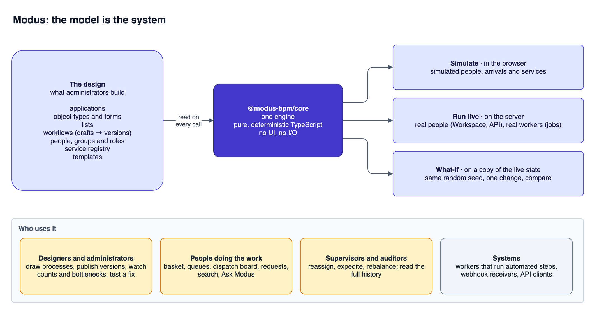
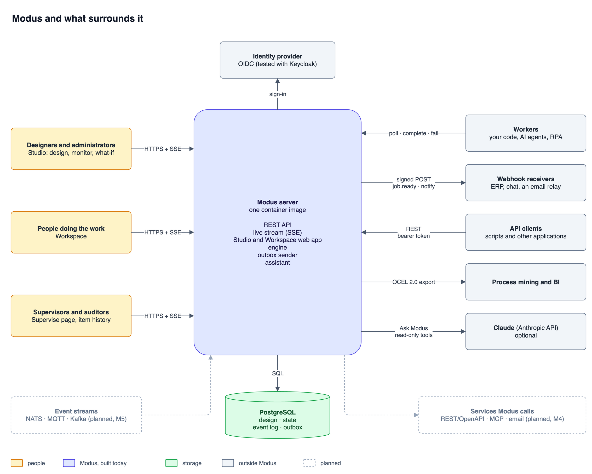
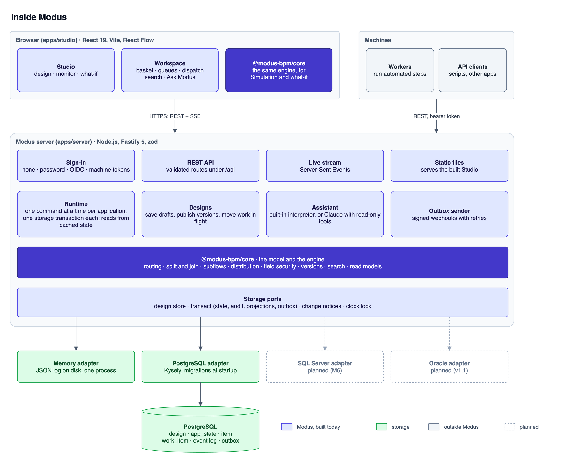
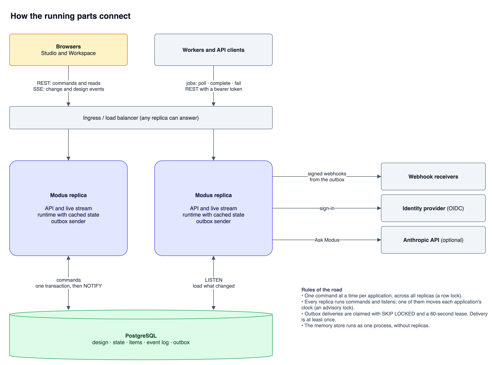
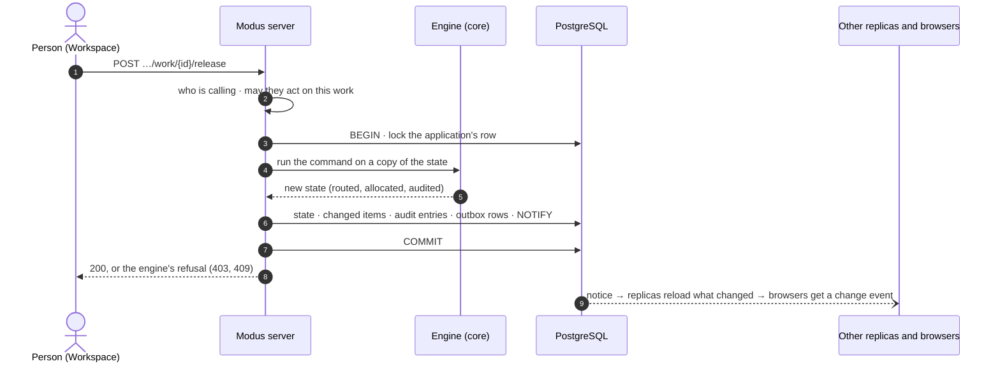
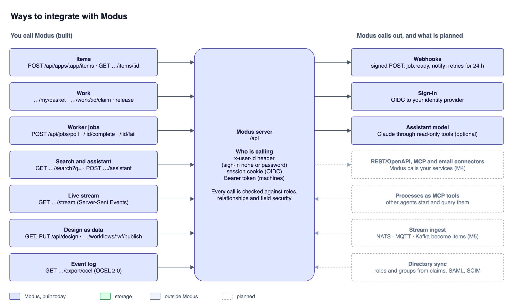
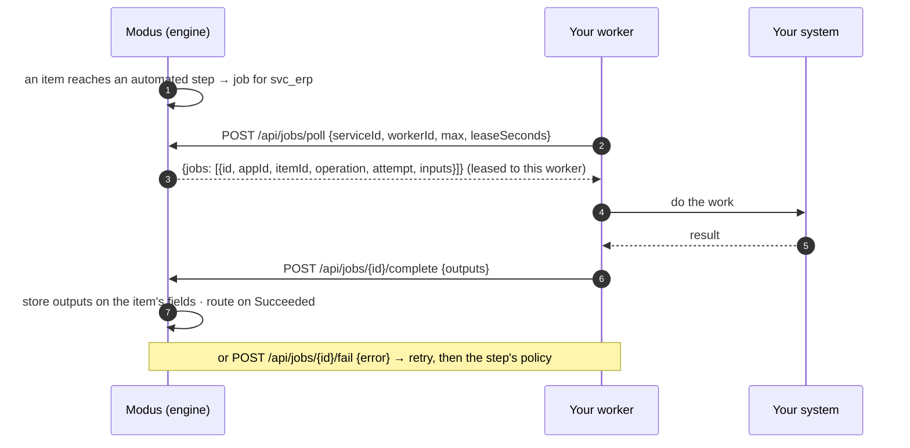
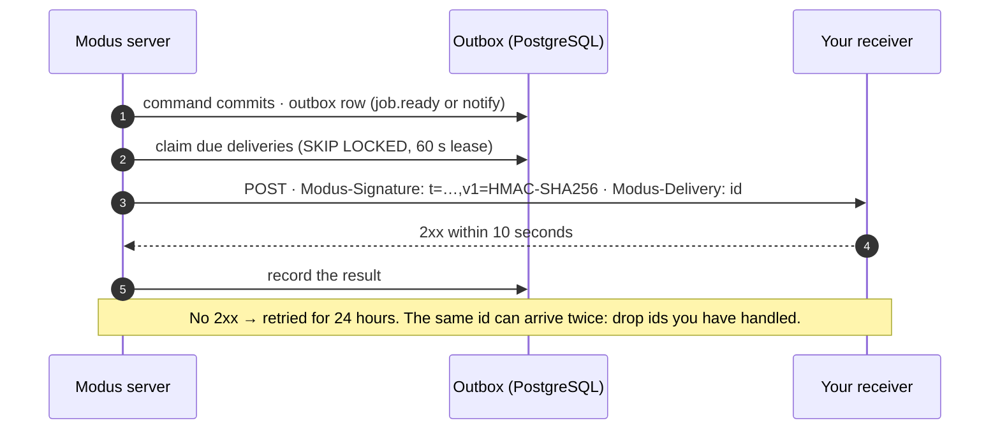
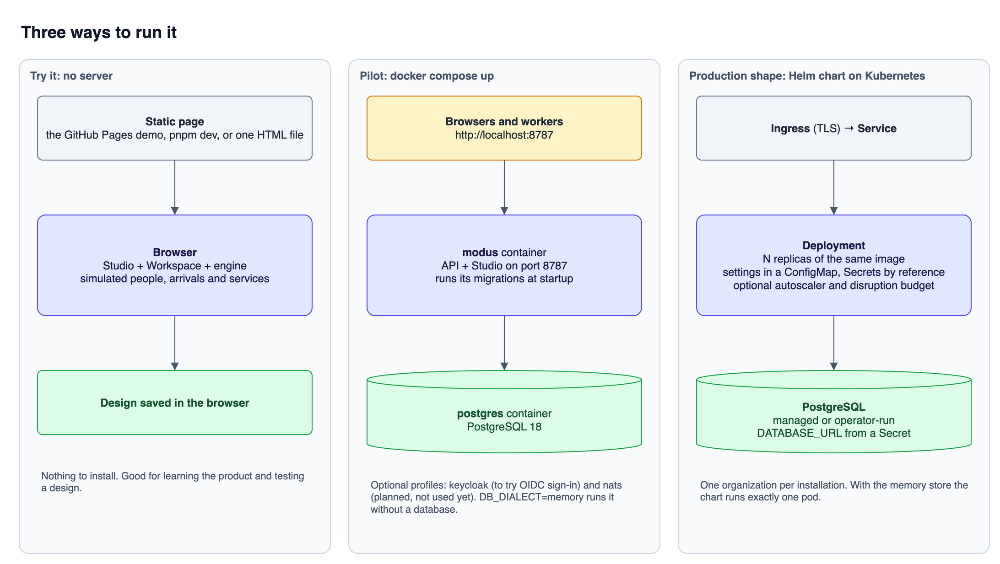

# Platform overview

What Modus is, how it is built, how its parts connect and how other systems plug into it, in
six diagrams. This page is the map; the detail lives in [ARCHITECTURE.md](ARCHITECTURE.md),
[TECH-STACK.md](TECH-STACK.md) and [DEPLOYMENT.md](DEPLOYMENT.md).

- [What Modus is](#1-what-modus-is)
- [What surrounds it](#2-what-surrounds-it)
- [How it is architected](#3-how-it-is-architected)
- [How the parts connect](#4-how-the-parts-connect)
- [How to integrate with it](#5-how-to-integrate-with-it)
- [How it is deployed](#6-how-it-is-deployed)
- [What is built and what is planned](#what-is-built-and-what-is-planned)

In every diagram a solid box exists today and a dashed box is planned.

## 1. What Modus is

Modus is an open-source process manager (business process management, case work, approvals,
and signal-driven processes such as camera events screened by AI). An administrator draws a
process, people and systems do the work it hands out, and the same drawing shows where work is
piling up.

Its central idea is that **the model is the system**. The design an administrator builds is the
thing that runs, the thing that is simulated and the thing that is monitored. There is no
generated code and no second copy that can drift.



- **The design** is data: applications, object types (with generated forms), lists, workflows,
  people and groups, the service registry and templates. Workflows have drafts and numbered
  versions; each item runs the version it started on.
- **The engine** (`@modus-bpm/core`) is pure, deterministic TypeScript with no UI and no I/O.
  It reads the design on every call.
- **Three ways to run it**, all on the same engine code:
  - *Simulate* in the browser, with simulated people, arrivals and services.
  - *Run live* on the server, where people act through the Workspace or the API and automated
    steps become jobs for real workers.
  - *What-if*: copy the live state, change one thing, run both forward with the same random
    numbers and compare.

The words used in the product (item, basket, queue, parallel split, join, subflow) and their
BPMN equivalents are in [CONCEPTS.md](CONCEPTS.md).

## 2. What surrounds it



| Who or what | How it reaches Modus |
| --- | --- |
| Designers and administrators | The Studio in a browser: design, publish, monitor, what-if. |
| People doing the work | The Workspace in a browser: basket, queues, dispatch board, requests, search, Ask Modus. |
| Supervisors and auditors | The Workspace's Supervise page; the full history of every item. |
| Workers | Your code, an AI agent or an RPA bot polls for jobs and reports results over REST. |
| Webhook receivers | Modus posts signed messages when a job is ready or someone should be notified. |
| API clients | Scripts and other applications create items, read them and act as a person. |
| Process mining and BI tools | Read the event log as OCEL 2.0. |
| Identity provider | OIDC sign-in (tested with Keycloak). |
| Claude (optional) | Ask Modus can answer with a model, through read-only tools that run as the person asking. |
| PostgreSQL | Holds the design, the live state, the event log and the outbox. |

## 3. How it is architected

The repository has three parts, and the diagram follows them:

```
packages/core   the model and the engine
apps/studio     the Studio and the Workspace (React)
apps/server     the engine behind a REST API, a worker job protocol and a live stream
```



Reading it from the top:

- **The browser** runs the Studio and the Workspace. It also carries its own copy of the engine,
  which is what makes Simulation and what-if work with no server at all.
- **The server's edge** decides who is calling (sign-in), validates each request, streams
  changes to browsers and serves the built Studio, so the whole product is one port.
- **The runtime** runs every command against one application at a time, each inside a single
  storage transaction, and answers reads from a cached state.
- **The engine** is the same package the browser uses. On the server it runs with the simulated
  people and arrivals switched off.
- **Storage ports** are the only way the server touches storage. Two adapters implement them
  today: memory (a JSON log on disk, one process) and PostgreSQL. SQL Server and Oracle are
  planned behind the same ports and must pass the same contract test suite.

Authorization rules (roles, supervision, field security) are pure functions in the engine. The
browser uses them to show the right controls and the server uses them to enforce the answer.

More: [ARCHITECTURE.md › Call stack](ARCHITECTURE.md#call-stack-target) for the target
architecture, and [Persistence](ARCHITECTURE.md#persistence-and-database-strategy) for the
database design.

## 4. How the parts connect



| Connection | Protocol | What travels |
| --- | --- | --- |
| Browser → server | HTTPS, REST | Commands (claim, release, save, publish) and reads. |
| Server → browser | Server-Sent Events | `change` events with the ids of changed items and counts per step, and `design` events. Ids and counts only, never item data. |
| Worker → server | HTTPS, REST, bearer token | Poll for jobs, complete or fail them. |
| Server → PostgreSQL | SQL (Kysely) | One transaction per command: state, changed items, audit entries, outbox rows. |
| Replica ↔ replica | PostgreSQL `LISTEN/NOTIFY` | "This application is now at version N"; the others load what changed. |
| Server → webhook receivers | HTTPS POST, HMAC-signed | `job.ready` and `notify` messages from the outbox. |
| Server → identity provider | OIDC | Sign-in. The session is a signed cookie, so any replica accepts it. |
| Server → Anthropic API | HTTPS | Ask Modus, only when a key is set. |

What happens when a person releases a work item:



Three rules keep several replicas correct:

- One command at a time per application, across all replicas (a row lock).
- One replica moves each application's clock (an advisory lock).
- Outbox deliveries are claimed with `SKIP LOCKED` and a 60-second lease, so two replicas don't
  send the same message at once. Delivery is still at least once.

The full sequence is in
[ARCHITECTURE.md › One transaction per command](ARCHITECTURE.md#one-transaction-per-command-m2).

## 5. How to integrate with it



### Identify the caller

Every route under `/api` acts as a person in the design. How the server learns who depends on
the `MODUS_AUTH` setting:

| Caller | Sends | Notes |
| --- | --- | --- |
| A machine (worker, script) | `Authorization: Bearer <token>` | Tokens are listed in `MODUS_API_TOKENS` as `personId:token`. Works in every sign-in mode. Give each machine its own person with only the roles it needs. |
| A person, `MODUS_AUTH=oidc` | A signed session cookie | The identity provider says who signed in. |
| Anyone, `MODUS_AUTH=none` or `password` | `x-user-id: <personId>` | Taken at its word. For a laptop or a demo only. |

Details: [DEPLOYMENT.md › Sign-in](DEPLOYMENT.md#sign-in).

### Create items and act on work (REST)

```bash
# Start a process: create an item
curl -X POST https://modus.example.org/api/apps/app_invoice/items \
  -H "Authorization: Bearer $TOKEN" -H 'content-type: application/json' \
  -d '{"workflowId":"w_invoice","data":{"f_invno":"A-1"}}'

# Read it back (fields hidden from this caller are left out)
curl -H "Authorization: Bearer $TOKEN" https://modus.example.org/api/apps/app_invoice/items/o1
```

The same API the Workspace uses is open to any client: baskets and queues (`…/my/basket`,
`…/my/queues`), work actions (`…/work/:id/claim · start · save · release · return · delegate`),
search (`…/search?q=`), the assistant (`…/assistant`) and the design itself (`GET` and `PUT
/api/design`). The whole surface is listed in
[ARCHITECTURE.md › API surface](ARCHITECTURE.md#api-surface-v0-implemented-in-the-skeleton).

### Run automated steps (the worker job protocol)

An automated step calls a registered service. On the server that call becomes a **job**, and a
worker you write picks it up. Workers only make outbound requests, so they can sit behind a
firewall.



- Only the people a service lists under **May run its jobs** (in the Studio, under
  Integrations), and administrators, can poll or answer for that service.
- A job that is no longer open (finished, cancelled, or taken over by a person) answers `410`.
- A service's capacity limits calls in flight. Failures retry, then follow the step's policy:
  the *Failed* path, a person in a fallback group, or stop for an administrator.
- Outputs are data. Routing comes from the rules an administrator wrote, never from the worker.

A working example is in `apps/server/examples/worker.ts`:

```bash
SERVICE=svc_erp pnpm --filter @modus-bpm/server worker
```

### Receive events (webhooks)

Modus writes an outbox message in the same transaction as the change that caused it, then posts
it to every configured endpoint.



| Kind | Sent when | Payload |
| --- | --- | --- |
| `job.ready` | A service job is ready for a worker | `{ tokenId, serviceId, nodeId, attempt }` |
| `notify` | A notification or an escalation | The item's audit entry |

Endpoints are set with `WEBHOOK_URL` and `WEBHOOK_SECRET`, or a `WEBHOOKS_FILE` listing several
with filters by application and kind. Settings, signature verification and retries:
[DEPLOYMENT.md › Webhooks](DEPLOYMENT.md#webhooks).

A common pairing: a `job.ready` webhook wakes a worker, which then polls for the job.

### Attach files

Upload the bytes, then put what the server answers into a file field when you create or save an
item:

```bash
curl -X POST "https://modus.example.org/api/apps/app_invoice/files?name=scan.pdf&kind=application/pdf" \
  -H "Authorization: Bearer $TOKEN" -H 'content-type: application/octet-stream' --data-binary @scan.pdf
# → {"ok":true,"value":{"id":"f_…","name":"scan.pdf","size":48213,"kind":"application/pdf","sha256":"…"}}
```

A worker can do the same and return the file in a job's outputs. Files come back from
`GET …/items/:id/files/:fileId`, to anyone who may read that field of that item.

### Follow live changes (Server-Sent Events)

```bash
curl -N -H "Authorization: Bearer $TOKEN" https://modus.example.org/api/apps/app_invoice/stream
```

Each `change` event carries the clock, counts per step and the ids of the items that changed.
`items: null` means too much changed to list: refetch.

### Take the event log out (process mining)

`GET /api/apps/:app/export/ocel` returns the event log as OCEL 2.0 JSON. It is for
administrators and auditors, and leaves out fields hidden from the person asking.

### Planned integrations

| Integration | Milestone |
| --- | --- |
| REST/OpenAPI and MCP connectors (Modus calls your services directly), email from Modus | M4 |
| Worker SDKs for TypeScript, Python, .NET and Java | M4 |
| Processes exposed as MCP tools, so other agents can start and query them | Planned |
| Stream ingest from NATS JetStream, MQTT and Kafka, with triage and bulk create | M5 |
| Roles and groups from identity-provider claims, SAML, SCIM group sync | M2–M6 |

Until the connectors land, a worker is how Modus reaches a REST API or an MCP server: the
service is registered in the design, and the worker makes the call.

## 6. How it is deployed



| Shape | Command | Storage |
| --- | --- | --- |
| Browser only | Open the [live demo](https://modus-bpm.github.io/modus/), or `pnpm dev` | The browser |
| One container and PostgreSQL | `docker compose up` → http://localhost:8787 | PostgreSQL 18 (or `DB_DIALECT=memory`) |
| Kubernetes | `helm install modus deploy/helm/modus` | PostgreSQL through `DATABASE_URL` in a Secret; several replicas |

It is one image (`ghcr.io/modus-bpm/modus`, amd64 and arm64) in every case: the API and the
Studio on one port, with schema migrations run at startup. One installation serves one
organization.

> **The default trusts whoever calls.** With `MODUS_AUTH=none` anyone who can reach the server
> can act as anyone. Set `MODUS_AUTH=password` for a demo or `MODUS_AUTH=oidc` for real work
> before other people can reach it.

Everything else (configuration, TLS, backups, upgrades, air-gapped installs):
[DEPLOYMENT.md](DEPLOYMENT.md).

## What is built and what is planned

| Area | Today | Planned |
| --- | --- | --- |
| Engine, Studio, Workspace | Complete as a browser prototype; on a server the Workspace, the Monitor and the designer pages work on live data | Engine split for per-item locking (M1) |
| Server | REST API, live stream, worker job protocol, one transaction per command | Roles split across deployments |
| Storage | PostgreSQL with several replicas; memory for one process | SQL Server (M6), Oracle (v1.1) |
| Sign-in | None, shared password, OIDC; machine tokens | Claims-based roles, SAML, SCIM |
| Outbound | Signed webhooks with retries | REST, MCP and email connectors (M4) |
| Inbound events | The API | Stream ingest (M5) |
| Assistant | Built-in interpreter; Claude with read-only tools when a key is set | |
| Attachments | Files uploaded to and served by the server, kept in PostgreSQL | S3-compatible storage for large files |
| Forms and look | A forms builder per object type; the Workspace branded per organization or application | Per-step layouts |
| Tenancy | One organization per installation | Multi-tenancy (M6) |
| Observability | JSON logs, live counts, OCEL 2.0 export | OpenTelemetry traces, Prometheus metrics |

The order of the next work is in [ROADMAP.md](ROADMAP.md#next).

## Editing the diagrams

The images in `docs/diagrams` are `.drawio.png` files: ordinary PNGs with the diagram embedded.
Open one in [draw.io](https://www.drawio.com/) (desktop or web), change it, and export it again
as PNG with **Include a copy of my diagram** ticked.
