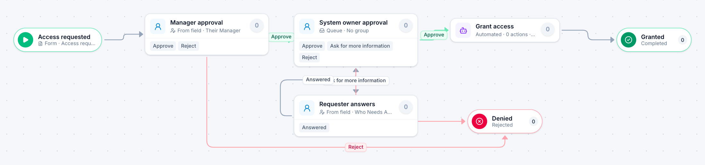

# Access request

[Starter templates](../TEMPLATES.md) › IT and security

The person’s manager approves, then the system’s owner, who can ask the requester for more information. Access is granted only after both say yes.

4 steps · 3 people steps · 1 step for a system of yours. Each item is an **Access request**. Tags: two approvals, return for changes, permissions.

## Steps

| Step | Kind | What it does | Then |
| --- | --- | --- | --- |
| **Access requested** | Start | Someone fills in the form. | → Manager approval |
| **Manager approval** | Person | Goes to the person named in “Their Manager”. Due in 2 days. | **Approve** → System owner approval **Reject** (with a comment) → Denied |
| **System owner approval** | Person | A queue: any member of the group claims it. Due in 2 days. | **Approve** → Grant access **Ask for more information** (with a comment) → Requester answers **Reject** (with a comment) → Denied |
| **Requester answers** | Person | Goes to the person named in “Who Needs Access”. Due in 1 day. | **Answered** → System owner approval |
| **Grant access** | Automated | **Your system.** A placeholder until you point it at a service of your own; until then it takes its time and passes the item on. | → Granted |
| **Denied** | End | Ends the item as Rejected. |  |
| **Granted** | End | Ends the item as Completed. |  |

## Fields

| Field | Type | Notes |
| --- | --- | --- |
| Who Needs Access | Person | Required · Shown on work cards |
| Their Manager | Person | Required |
| System | Text | Required · Shown on work cards |
| Why It Is Needed | Long text | Required |
| Needed Until | Date |  |

## Use it

In the Studio, open **Templates** and find **Access request**. Start a new application from it, or add it to an application you have and map its fields onto yours.

Then make it your own: pick the group that does each people step, point the steps marked *your system* at your services, change the thresholds and deadlines, publish, and run the simulation to watch work move through it.

---

← [Service desk ticket](service-desk-ticket.md) · [All templates](../TEMPLATES.md) · [Equipment request](equipment-request.md) →
