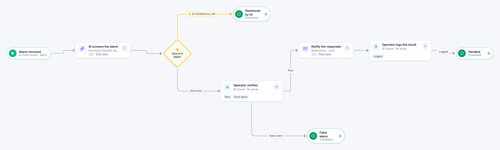

# Alarm screening

[Starter templates](../TEMPLATES.md) › Facilities, fleet and safety

An AI agent screens every alarm and dismisses the ones it is sure are false. An operator verifies the rest and the responder is told only about real ones.

5 steps · 2 people steps. Each item is an **Alarm**. Tags: AI, human in the loop, security operations.

## Steps

| Step | Kind | What it does | Then |
| --- | --- | --- | --- |
| **Alarm received** | Start | Every message on an event stream becomes an item. | → AI screens the alarm |
| **AI screens the alarm** | Automated | Calls the sample service “Document Classifier Agent”. If the call fails, a person does the step by hand. | → Sure it is false? |
| **Sure it is false?** | Decision | Checks its rules from the top; the first one that matches wins. | **AI Confidence ≥ 90** → Dismissed by AI **Otherwise** → Operator verifies |
| **Operator verifies** | Person | A queue: any member of the group claims it. Due in 1 hour. | **Real** → Notify the responder **False alarm** → False alarm |
| **Dismissed by AI** | End | Ends the item as Completed. |  |
| **Notify the responder** | Automated | Calls the sample service “Notifications”. If the call fails, a person does the step by hand. | → Operator logs the result |
| **False alarm** | End | Ends the item as Completed. |  |
| **Operator logs the result** | Person | A queue: any member of the group claims it. Due in 1 day. | **Logged** → Handled |
| **Handled** | End | Ends the item as Completed. |  |

## Fields

| Field | Type | Notes |
| --- | --- | --- |
| Site | Text | Required · Shown on work cards |
| Alarm Point | Text | Shown on work cards |
| AI Confidence | Number | Set by the process |
| AI Label | Text | Set by the process |

## Use it

In the Studio, open **Templates** and find **Alarm screening**. Start a new application from it, or add it to an application you have and map its fields onto yours.

Then make it your own: pick the group that does each people step, change the thresholds and deadlines, publish, and run the simulation to watch work move through it.

---

← [Safety near-miss](safety-near-miss.md) · [All templates](../TEMPLATES.md) · [Public records request](public-records-request.md) →
