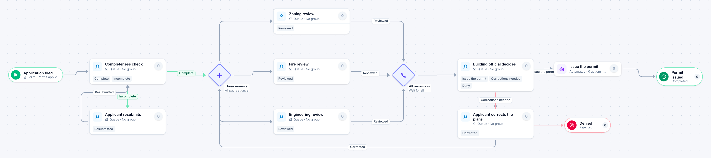

# Building permit review

[Starter templates](../TEMPLATES.md) › Government and public safety

After a completeness check, zoning, fire and engineering review the plans at the same time. The building official then issues the permit, denies it, or sends the plans back to the applicant for corrections and another round.

10 steps · 7 people steps · 1 step for a system of yours. Each item is a **Permit application**. Tags: parallel, corrections, permits.

## Steps

| Step | Kind | What it does | Then |
| --- | --- | --- | --- |
| **Application filed** | Start | Someone fills in the form. | → Completeness check |
| **Completeness check** | Person | A queue: any member of the group claims it. Due in 1 day. | **Complete** → Three reviews **Incomplete** (with a comment) → Applicant resubmits |
| **Applicant resubmits** | Person | A queue: any member of the group claims it. Due in 10 days. | **Resubmitted** → Completeness check |
| **Three reviews** | Parallel split | Starts every path at the same time. | → Zoning review → Fire review → Engineering review |
| **Zoning review** | Person | A queue: any member of the group claims it. Due in 5 days. | **Reviewed** → All reviews in |
| **Fire review** | Person | A queue: any member of the group claims it. Due in 5 days. | **Reviewed** → All reviews in |
| **Engineering review** | Person | A queue: any member of the group claims it. Due in 5 days. | **Reviewed** → All reviews in |
| **All reviews in** | Join | Waits for every branch. | → Building official decides |
| **Building official decides** | Person | A queue: any member of the group claims it. Due in 1 day. | **Issue the permit** → Issue the permit **Corrections needed** (with a comment) → Applicant corrects the plans **Deny** (with a comment) → Denied |
| **Applicant corrects the plans** | Person | A queue: any member of the group claims it. Due in 20 days. | **Corrected** → Three reviews |
| **Issue the permit** | Automated | **Your system.** A placeholder until you point it at a service of your own; until then it takes its time and passes the item on. | → Permit issued |
| **Denied** | End | Ends the item as Rejected. |  |
| **Permit issued** | End | Ends the item as Completed. |  |

## Fields

| Field | Type | Notes |
| --- | --- | --- |
| Site Address | Text | Required · Shown on work cards |
| Applicant | Text | Required · Shown on work cards |
| Project Value | Currency |  |
| Plans | Attachment |  |
| Review Comments | Long text |  |

## Use it

In the Studio, open **Templates** and find **Building permit review**. Start a new application from it, or add it to an application you have and map its fields onto yours.

Then make it your own: pick the group that does each people step, point the steps marked *your system* at your services, change the thresholds and deadlines, publish, and run the simulation to watch work move through it.

---

← [Public records request](public-records-request.md) · [All templates](../TEMPLATES.md) · [Business license application](business-license-application.md) →
