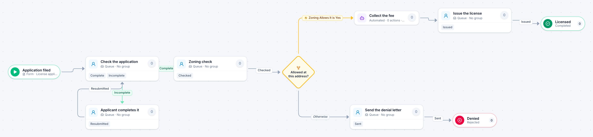

# Business license application

[Starter templates](../TEMPLATES.md) › Government and public safety

The clerk checks the application and sends incomplete ones back. A zoning check decides whether the business is allowed at that address; if it is, the fee is collected and the license issued.

7 steps · 5 people steps · 1 step for a system of yours. Each item is a **License application**. Tags: return for changes, licensing, zoning.

## Steps

| Step | Kind | What it does | Then |
| --- | --- | --- | --- |
| **Application filed** | Start | Someone fills in the form. | → Check the application |
| **Check the application** | Person | A queue: any member of the group claims it. Due in 1 day. | **Complete** → Zoning check **Incomplete** (with a comment) → Applicant completes it |
| **Applicant completes it** | Person | A queue: any member of the group claims it. Due in 10 days. | **Resubmitted** → Check the application |
| **Zoning check** | Person | A queue: any member of the group claims it. Due in 3 days. | **Checked** → Allowed at this address? |
| **Allowed at this address?** | Decision | Checks its rules from the top; the first one that matches wins. | **Zoning Allows It is Yes** → Collect the fee **Otherwise** → Send the denial letter |
| **Send the denial letter** | Person | A queue: any member of the group claims it. Due in 1 day. | **Sent** → Denied |
| **Collect the fee** | Automated | **Your system.** A placeholder until you point it at a service of your own; until then it takes its time and passes the item on. | → Issue the license |
| **Issue the license** | Person | A queue: any member of the group claims it. Due in 1 day. | **Issued** → Licensed |
| **Denied** | End | Ends the item as Rejected. |  |
| **Licensed** | End | Ends the item as Completed. |  |

## Fields

| Field | Type | Notes |
| --- | --- | --- |
| Business Name | Text | Required · Shown on work cards |
| Owner | Text | Required |
| Address | Text | Required · Shown on work cards |
| Zoning Allows It | Yes / No |  |

## Use it

In the Studio, open **Templates** and find **Business license application**. Start a new application from it, or add it to an application you have and map its fields onto yours.

Then make it your own: pick the group that does each people step, point the steps marked *your system* at your services, change the thresholds and deadlines, publish, and run the simulation to watch work move through it.

---

← [Building permit review](building-permit-review.md) · [All templates](../TEMPLATES.md) · [Code enforcement complaint](code-enforcement-complaint.md) →
