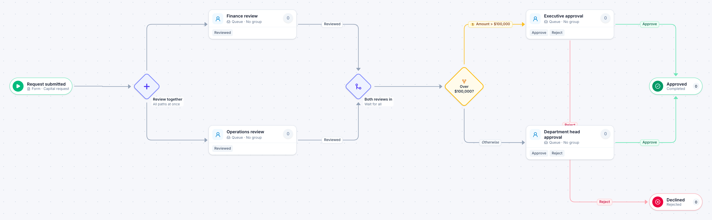

# Capital expenditure request

[Starter templates](../TEMPLATES.md) › Finance and AP

Finance and operations review the business case at the same time. The department head decides requests up to $100,000; anything larger goes to an executive.

7 steps · 4 people steps. Each item is a **Capital request**. Tags: parallel, threshold, capex.

## Steps

| Step | Kind | What it does | Then |
| --- | --- | --- | --- |
| **Request submitted** | Start | Someone fills in the form. | → Review together |
| **Review together** | Parallel split | Starts every path at the same time. | → Finance review → Operations review |
| **Finance review** | Person | A queue: any member of the group claims it. Due in 3 days. | **Reviewed** → Both reviews in |
| **Operations review** | Person | A queue: any member of the group claims it. Due in 3 days. | **Reviewed** → Both reviews in |
| **Both reviews in** | Join | Waits for every branch. | → Over $100,000? |
| **Over $100,000?** | Decision | Checks its rules from the top; the first one that matches wins. | **Amount > $100,000** → Executive approval **Otherwise** → Department head approval |
| **Executive approval** | Person | A queue: any member of the group claims it. Due in 5 days. | **Approve** → Approved **Reject** (with a comment) → Declined |
| **Department head approval** | Person | A queue: any member of the group claims it. Due in 3 days. | **Approve** → Approved **Reject** (with a comment) → Declined |
| **Approved** | End | Ends the item as Completed. |  |
| **Declined** | End | Ends the item as Rejected. |  |

## Fields

| Field | Type | Notes |
| --- | --- | --- |
| Project | Text | Required · Shown on work cards |
| Amount | Currency | Required · Shown on work cards |
| Business Case | Long text | Required |
| Quote | Attachment |  |

## Use it

In the Studio, open **Templates** and find **Capital expenditure request**. Start a new application from it, or add it to an application you have and map its fields onto yours.

Then make it your own: pick the group that does each people step, change the thresholds and deadlines, publish, and run the simulation to watch work move through it.

---

← [Refund or credit](refund-or-credit.md) · [All templates](../TEMPLATES.md) · [Purchase request](purchase-request.md) →
