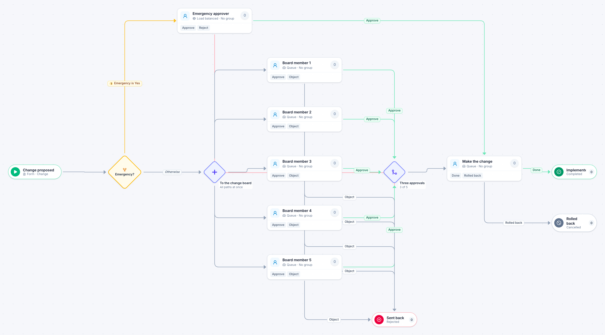

# Change request

[Starter templates](../TEMPLATES.md) › IT and security

An emergency change goes to one emergency approver. Every other change goes to five board members at once and proceeds when three have approved; an objection sends it back.

10 steps · 7 people steps. Each item is a **Change**. Tags: three of five, change board, emergency path.

## Steps

| Step | Kind | What it does | Then |
| --- | --- | --- | --- |
| **Change proposed** | Start | Someone fills in the form. | → Emergency? |
| **Emergency?** | Decision | Checks its rules from the top; the first one that matches wins. | **Emergency is Yes** → Emergency approver **Otherwise** → To the change board |
| **Emergency approver** | Person | Load balanced: each item goes to the member with the fewest open items. Due in 1 hour. | **Approve** → Make the change **Reject** (with a comment) → Sent back |
| **To the change board** | Parallel split | Starts every path at the same time. | → Board member 1 → Board member 2 → Board member 3 → Board member 4 → Board member 5 |
| **Board member 1** | Person | A queue: any member of the group claims it. Due in 3 days. | **Approve** → Three approvals **Object** (with a comment) → Sent back |
| **Board member 2** | Person | A queue: any member of the group claims it. Due in 3 days. | **Approve** → Three approvals **Object** (with a comment) → Sent back |
| **Board member 3** | Person | A queue: any member of the group claims it. Due in 3 days. | **Approve** → Three approvals **Object** (with a comment) → Sent back |
| **Board member 4** | Person | A queue: any member of the group claims it. Due in 3 days. | **Approve** → Three approvals **Object** (with a comment) → Sent back |
| **Board member 5** | Person | A queue: any member of the group claims it. Due in 3 days. | **Approve** → Three approvals **Object** (with a comment) → Sent back |
| **Sent back** | End | Ends the item as Rejected. |  |
| **Three approvals** | Join | Continues when 3 of 5 branches have arrived. The branches still running are withdrawn. | → Make the change |
| **Make the change** | Person | A queue: any member of the group claims it. Due in 3 days. | **Done** → Implemented **Rolled back** (with a comment) → Rolled back |
| **Implemented** | End | Ends the item as Completed. |  |
| **Rolled back** | End | Ends the item as Cancelled. |  |

## Fields

| Field | Type | Notes |
| --- | --- | --- |
| Change | Text | Required · Shown on work cards |
| Planned For | Date | Required · Shown on work cards |
| Emergency | Yes / No |  |
| Risk and Rollback Plan | Long text | Required |

## Use it

In the Studio, open **Templates** and find **Change request**. Start a new application from it, or add it to an application you have and map its fields onto yours.

Then make it your own: pick the group that does each people step, change the thresholds and deadlines, publish, and run the simulation to watch work move through it.

---

← [Equipment request](equipment-request.md) · [All templates](../TEMPLATES.md) · [Major incident](major-incident.md) →
