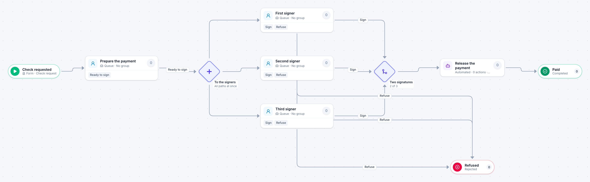

# Check request

[Starter templates](../TEMPLATES.md) › Finance and AP

A payment outside the normal invoice run goes to three authorized signers at once and is released as soon as any two have signed. One refusal stops it.

7 steps · 4 people steps · 1 step for a system of yours. Each item is a **Check request**. Tags: two of three, dual signature, payment.

## Steps

| Step | Kind | What it does | Then |
| --- | --- | --- | --- |
| **Check requested** | Start | Someone fills in the form. | → Prepare the payment |
| **Prepare the payment** | Person | A queue: any member of the group claims it. Due in 1 day. | **Ready to sign** → To the signers |
| **To the signers** | Parallel split | Starts every path at the same time. | → First signer → Second signer → Third signer |
| **First signer** | Person | A queue: any member of the group claims it. Due in 2 days. | **Sign** → Two signatures **Refuse** (with a comment) → Refused |
| **Second signer** | Person | A queue: any member of the group claims it. Due in 2 days. | **Sign** → Two signatures **Refuse** (with a comment) → Refused |
| **Third signer** | Person | A queue: any member of the group claims it. Due in 2 days. | **Sign** → Two signatures **Refuse** (with a comment) → Refused |
| **Two signatures** | Join | Continues when 2 of 3 branches have arrived. The branches still running are withdrawn. | → Release the payment |
| **Release the payment** | Automated | **Your system.** A placeholder until you point it at a service of your own; until then it takes its time and passes the item on. | → Paid |
| **Refused** | End | Ends the item as Rejected. |  |
| **Paid** | End | Ends the item as Completed. |  |

## Fields

| Field | Type | Notes |
| --- | --- | --- |
| Payee | Text | Required · Shown on work cards |
| Amount | Currency | Required · Shown on work cards |
| Reason | Long text | Required |
| Supporting Document | Attachment |  |

## Use it

In the Studio, open **Templates** and find **Check request**. Start a new application from it, or add it to an application you have and map its fields onto yours.

Then make it your own: pick the group that does each people step, point the steps marked *your system* at your services, change the thresholds and deadlines, publish, and run the simulation to watch work move through it.

---

← [Vendor bank change](vendor-bank-change.md) · [All templates](../TEMPLATES.md) · [Refund or credit](refund-or-credit.md) →
