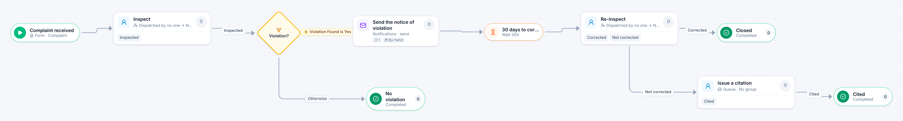

# Code enforcement complaint

[Starter templates](../TEMPLATES.md) › Government and public safety

An officer inspects. If there is a violation, a notice goes out and the case waits 30 days; a re-inspection then closes it or leads to a citation.

6 steps · 3 people steps. Each item is a **Complaint**. Tags: timer, inspection, re-inspect.

## Steps

| Step | Kind | What it does | Then |
| --- | --- | --- | --- |
| **Complaint received** | Start | Someone fills in the form. | → Inspect |
| **Inspect** | Person | A dispatcher hands each item to someone. Due in 5 days. | **Inspected** → Violation? |
| **Violation?** | Decision | Checks its rules from the top; the first one that matches wins. | **Violation Found is Yes** → Send the notice of violation **Otherwise** → No violation |
| **Send the notice of violation** | Automated | Calls the sample service “Notifications”. If the call fails, a person does the step by hand. | → 30 days to correct it |
| **No violation** | End | Ends the item as Completed. |  |
| **30 days to correct it** | Timer | Waits 30 days. | → Re-inspect |
| **Re-inspect** | Person | A dispatcher hands each item to someone. Due in 5 days. | **Corrected** → Closed **Not corrected** (with a comment) → Issue a citation |
| **Issue a citation** | Person | A queue: any member of the group claims it. Due in 1 day. | **Cited** → Cited |
| **Closed** | End | Ends the item as Completed. |  |
| **Cited** | End | Ends the item as Completed. |  |

## Fields

| Field | Type | Notes |
| --- | --- | --- |
| Address | Text | Required · Shown on work cards |
| Complaint | Long text | Required |
| Violation Found | Yes / No |  |
| Findings | Long text |  |

## Use it

In the Studio, open **Templates** and find **Code enforcement complaint**. Start a new application from it, or add it to an application you have and map its fields onto yours.

Then make it your own: pick the group that does each people step, change the thresholds and deadlines, publish, and run the simulation to watch work move through it.

---

← [Business license application](business-license-application.md) · [All templates](../TEMPLATES.md) · [Resident service request](resident-service-request.md) →
