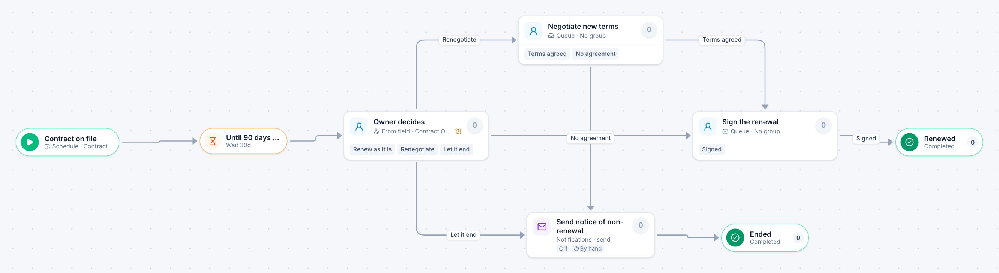

# Contract renewal

[Starter templates](../TEMPLATES.md) › Purchasing and contracts

A timer wakes the contract’s owner ahead of the end date. They renew it, renegotiate it or let it end, and it escalates if they have not decided within three days.

5 steps · 3 people steps. Each item is a **Contract**. Tags: timer, deadline, contracts.

## Steps

| Step | Kind | What it does | Then |
| --- | --- | --- | --- |
| **Contract on file** | Start | Items are created on a schedule. | → Until 90 days before it ends |
| **Until 90 days before it ends** | Timer | Waits 30 days. | → Owner decides |
| **Owner decides** | Person | Goes to the person named in “Contract Owner”. Due in 5 days. Escalates after 3 days. | **Renew as it is** → Sign the renewal **Renegotiate** → Negotiate new terms **Let it end** (with a comment) → Send notice of non-renewal |
| **Negotiate new terms** | Person | A queue: any member of the group claims it. Due in 10 days. | **Terms agreed** → Sign the renewal **No agreement** (with a comment) → Send notice of non-renewal |
| **Send notice of non-renewal** | Automated | Calls the sample service “Notifications”. If the call fails, a person does the step by hand. | → Ended |
| **Sign the renewal** | Person | A queue: any member of the group claims it. Due in 1 day. | **Signed** → Renewed |
| **Ended** | End | Ends the item as Completed. |  |
| **Renewed** | End | Ends the item as Completed. |  |

## Fields

| Field | Type | Notes |
| --- | --- | --- |
| Contract | Text | Required · Shown on work cards |
| Contract Owner | Person | Required |
| Annual Value | Currency | Shown on work cards |
| Vendor Contact | Email |  |

## Use it

In the Studio, open **Templates** and find **Contract renewal**. Start a new application from it, or add it to an application you have and map its fields onto yours.

Then make it your own: pick the group that does each people step, change the thresholds and deadlines, publish, and run the simulation to watch work move through it.

---

← [Software purchase](software-purchase.md) · [All templates](../TEMPLATES.md) · [New hire onboarding](new-hire-onboarding.md) →
