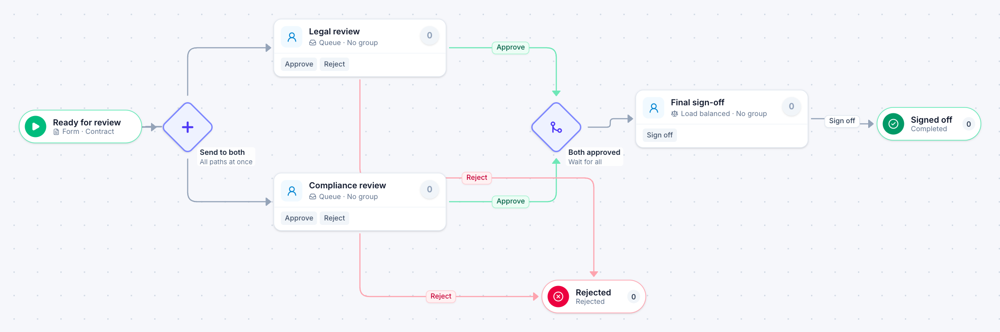

# Contract review

[Starter templates](../TEMPLATES.md) › Purchasing and contracts

Legal and compliance review the contract at the same time. Both must approve before final sign-off; a rejection from either stops the other.

5 steps · 3 people steps. Each item is a **Contract**. Tags: parallel, legal, compliance.

## Steps

| Step | Kind | What it does | Then |
| --- | --- | --- | --- |
| **Ready for review** | Start | Someone fills in the form. | → Send to both |
| **Send to both** | Parallel split | Starts every path at the same time. | → Legal review → Compliance review |
| **Legal review** | Person | A queue: any member of the group claims it. Due in 1 day. | **Approve** → Both approved **Reject** (with a comment) → Rejected |
| **Compliance review** | Person | A queue: any member of the group claims it. Due in 1 day. | **Approve** → Both approved **Reject** (with a comment) → Rejected |
| **Both approved** | Join | Waits for every branch. | → Final sign-off |
| **Rejected** | End | Ends the item as Rejected. |  |
| **Final sign-off** | Person | Load balanced: each item goes to the member with the fewest open items. Due in 1 day. | **Sign off** → Signed off |
| **Signed off** | End | Ends the item as Completed. |  |

## Fields

| Field | Type | Notes |
| --- | --- | --- |
| Document | Attachment |  |
| Review Notes | Long text |  |

## Use it

In the Studio, open **Templates** and find **Contract review**. Start a new application from it, or add it to an application you have and map its fields onto yours.

Then make it your own: pick the group that does each people step, change the thresholds and deadlines, publish, and run the simulation to watch work move through it.

---

← [Purchase request](purchase-request.md) · [All templates](../TEMPLATES.md) · [Three quotes](three-quotes.md) →
