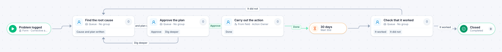

# Corrective action

[Starter templates](../TEMPLATES.md) › Customers and operations

Find the root cause, get the plan approved, and carry it out. Thirty days later someone checks whether it worked; if it did not, the case goes back to the root cause.

5 steps · 4 people steps. Each item is a **Corrective action**. Tags: timer, verify, quality.

## Steps

| Step | Kind | What it does | Then |
| --- | --- | --- | --- |
| **Problem logged** | Start | Someone fills in the form. | → Find the root cause |
| **Find the root cause** | Person | A queue: any member of the group claims it. Due in 5 days. | **Cause and plan written** → Approve the plan |
| **Approve the plan** | Person | A queue: any member of the group claims it. Due in 1 day. | **Approve** → Carry out the action **Dig deeper** (with a comment) → Find the root cause |
| **Carry out the action** | Person | Goes to the person named in “Action Owner”. Due in 10 days. | **Done** → 30 days |
| **30 days** | Timer | Waits 30 days. | → Check that it worked |
| **Check that it worked** | Person | A queue: any member of the group claims it. Due in 1 day. Not the person who did “Carry out the action”. | **It worked** → Closed **It did not** (with a comment) → Find the root cause |
| **Closed** | End | Ends the item as Completed. |  |

## Fields

| Field | Type | Notes |
| --- | --- | --- |
| Problem | Text | Required · Shown on work cards |
| Root Cause | Long text |  |
| Action | Long text |  |
| Action Owner | Person | Required |

## Use it

In the Studio, open **Templates** and find **Corrective action**. Start a new application from it, or add it to an application you have and map its fields onto yours.

Then make it your own: pick the group that does each people step, change the thresholds and deadlines, publish, and run the simulation to watch work move through it.

---

← [Discount approval](discount-approval.md) · [All templates](../TEMPLATES.md) · [Procedure change](procedure-change.md) →
