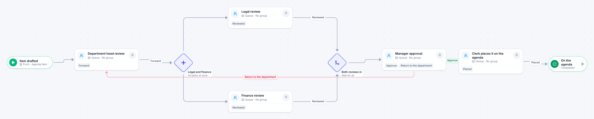

# Council agenda item

[Starter templates](../TEMPLATES.md) › Government and public safety

The department head forwards the item, legal and finance review it at the same time, and the manager approves it or returns it to the department before the clerk places it on the agenda.

7 steps · 5 people steps. Each item is an **Agenda item**. Tags: parallel, return for changes, clerk.

## Steps

| Step | Kind | What it does | Then |
| --- | --- | --- | --- |
| **Item drafted** | Start | Someone fills in the form. | → Department head review |
| **Department head review** | Person | A queue: any member of the group claims it. Due in 2 days. | **Forward** → Legal and finance |
| **Legal and finance** | Parallel split | Starts every path at the same time. | → Legal review → Finance review |
| **Legal review** | Person | A queue: any member of the group claims it. Due in 3 days. | **Reviewed** → Both reviews in |
| **Finance review** | Person | A queue: any member of the group claims it. Due in 3 days. | **Reviewed** → Both reviews in |
| **Both reviews in** | Join | Waits for every branch. | → Manager approval |
| **Manager approval** | Person | A queue: any member of the group claims it. Due in 2 days. | **Approve** → Clerk places it on the agenda **Return to the department** (with a comment) → Department head review |
| **Clerk places it on the agenda** | Person | A queue: any member of the group claims it. Due in 1 day. | **Placed** → On the agenda |
| **On the agenda** | End | Ends the item as Completed. |  |

## Fields

| Field | Type | Notes |
| --- | --- | --- |
| Item Title | Text | Required · Shown on work cards |
| Meeting Date | Date | Required · Shown on work cards |
| Fiscal Impact | Currency |  |
| Staff Report | Attachment |  |

## Use it

In the Studio, open **Templates** and find **Council agenda item**. Start a new application from it, or add it to an application you have and map its fields onto yours.

Then make it your own: pick the group that does each people step, change the thresholds and deadlines, publish, and run the simulation to watch work move through it.

---

← [Special event permit](special-event-permit.md) · [All templates](../TEMPLATES.md) · [Grant application review](grant-application-review.md) →
