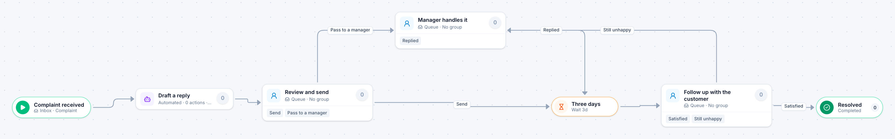

# Customer complaint

[Starter templates](../TEMPLATES.md) › Customers and operations

A draft reply is prepared automatically and a person always reviews it before anything is sent. Hard cases go to a manager, and a follow-up three days later reopens it if the customer is still unhappy.

5 steps · 3 people steps · 1 step for a system of yours. Each item is a **Complaint**. Tags: AI, follow-up, customer service.

## Steps

| Step | Kind | What it does | Then |
| --- | --- | --- | --- |
| **Complaint received** | Start | Every email that arrives in a mailbox becomes an item. | → Draft a reply |
| **Draft a reply** | Automated | **Your system.** A placeholder until you point it at a service of your own; until then it takes its time and passes the item on. | → Review and send |
| **Review and send** | Person | A queue: any member of the group claims it. Due in 1 day. | **Send** → Three days **Pass to a manager** → Manager handles it |
| **Manager handles it** | Person | A queue: any member of the group claims it. Due in 1 day. | **Replied** → Three days |
| **Three days** | Timer | Waits 3 days. | → Follow up with the customer |
| **Follow up with the customer** | Person | A queue: any member of the group claims it. Due in 1 day. | **Satisfied** → Resolved **Still unhappy** (with a comment) → Manager handles it |
| **Resolved** | End | Ends the item as Completed. |  |

## Fields

| Field | Type | Notes |
| --- | --- | --- |
| Customer | Text | Required · Shown on work cards |
| Complaint | Long text | Required |
| Reply | Long text |  |

## Use it

In the Studio, open **Templates** and find **Customer complaint**. Start a new application from it, or add it to an application you have and map its fields onto yours.

Then make it your own: pick the group that does each people step, point the steps marked *your system* at your services, change the thresholds and deadlines, publish, and run the simulation to watch work move through it.

---

← [Incident report](incident-report.md) · [All templates](../TEMPLATES.md) · [New client intake](new-client-intake.md) →
