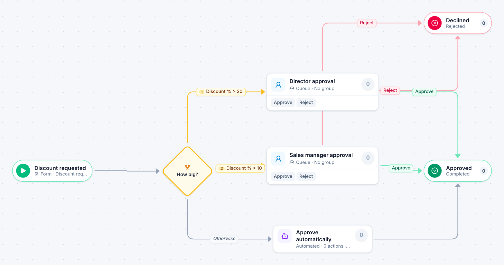

# Discount approval

[Starter templates](../TEMPLATES.md) › Customers and operations

The size of the discount decides who signs: up to 10% is approved automatically, up to 20% needs the sales manager, and anything more goes to a director.

4 steps · 2 people steps · 1 step for a system of yours. Each item is a **Discount request**. Tags: threshold, auto-approve, pricing.

## Steps

| Step | Kind | What it does | Then |
| --- | --- | --- | --- |
| **Discount requested** | Start | Someone fills in the form. | → How big? |
| **How big?** | Decision | Checks its rules from the top; the first one that matches wins. | **Discount % > 20** → Director approval **Discount % > 10** → Sales manager approval **Otherwise** → Approve automatically |
| **Director approval** | Person | A queue: any member of the group claims it. Due in 2 days. | **Approve** → Approved **Reject** (with a comment) → Declined |
| **Sales manager approval** | Person | A queue: any member of the group claims it. Due in 1 day. | **Approve** → Approved **Reject** (with a comment) → Declined |
| **Approve automatically** | Automated | **Your system.** A placeholder until you point it at a service of your own; until then it takes its time and passes the item on. | → Approved |
| **Declined** | End | Ends the item as Rejected. |  |
| **Approved** | End | Ends the item as Completed. |  |

## Fields

| Field | Type | Notes |
| --- | --- | --- |
| Customer | Text | Required · Shown on work cards |
| Deal Value | Currency | Shown on work cards |
| Discount % | Number | Required · Shown on work cards |
| Why | Long text |  |

## Use it

In the Studio, open **Templates** and find **Discount approval**. Start a new application from it, or add it to an application you have and map its fields onto yours.

Then make it your own: pick the group that does each people step, point the steps marked *your system* at your services, change the thresholds and deadlines, publish, and run the simulation to watch work move through it.

---

← [New client intake](new-client-intake.md) · [All templates](../TEMPLATES.md) · [Corrective action](corrective-action.md) →
