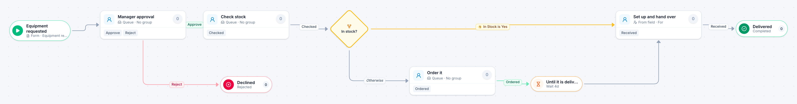

# Equipment request

[Starter templates](../TEMPLATES.md) › IT and security

After the manager approves, IT checks stock. What is on the shelf is handed over the same day; anything else is ordered and waits for delivery first.

6 steps · 4 people steps. Each item is an **Equipment request**. Tags: in stock or order, hardware, timer.

## Steps

| Step | Kind | What it does | Then |
| --- | --- | --- | --- |
| **Equipment requested** | Start | Someone fills in the form. | → Manager approval |
| **Manager approval** | Person | A queue: any member of the group claims it. Due in 2 days. | **Approve** → Check stock **Reject** (with a comment) → Declined |
| **Check stock** | Person | A queue: any member of the group claims it. Due in 1 day. | **Checked** → In stock? |
| **Declined** | End | Ends the item as Rejected. |  |
| **In stock?** | Decision | Checks its rules from the top; the first one that matches wins. | **In Stock is Yes** → Set up and hand over **Otherwise** → Order it |
| **Order it** | Person | A queue: any member of the group claims it. Due in 1 day. | **Ordered** → Until it is delivered |
| **Until it is delivered** | Timer | Waits 4 days. | → Set up and hand over |
| **Set up and hand over** | Person | Goes to the person named in “For”. Due in 1 day. | **Received** → Delivered |
| **Delivered** | End | Ends the item as Completed. |  |

## Fields

| Field | Type | Notes |
| --- | --- | --- |
| For | Person | Required · Shown on work cards |
| Item | Text | Required · Shown on work cards |
| Cost | Currency |  |
| In Stock | Yes / No |  |

## Use it

In the Studio, open **Templates** and find **Equipment request**. Start a new application from it, or add it to an application you have and map its fields onto yours.

Then make it your own: pick the group that does each people step, change the thresholds and deadlines, publish, and run the simulation to watch work move through it.

---

← [Access request](access-request.md) · [All templates](../TEMPLATES.md) · [Change request](change-request.md) →
