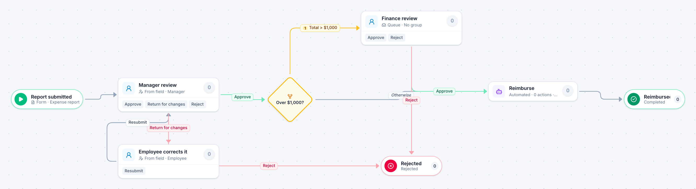

# Expense report

[Starter templates](../TEMPLATES.md) › Finance and AP

The employee’s own manager reviews it and can send it back for changes. Reports over $1,000 also go to finance before reimbursement.

5 steps · 3 people steps · 1 step for a system of yours. Each item is an **Expense report**. Tags: reimbursement, return for changes, threshold.

## Steps

| Step | Kind | What it does | Then |
| --- | --- | --- | --- |
| **Report submitted** | Start | Someone fills in the form. | → Manager review |
| **Manager review** | Person | Goes to the person named in “Manager”. Due in 2 days. | **Approve** → Over $1,000? **Return for changes** (with a comment) → Employee corrects it **Reject** (with a comment) → Rejected |
| **Employee corrects it** | Person | Goes to the person named in “Employee”. Due in 1 day. | **Resubmit** → Manager review |
| **Over $1,000?** | Decision | Checks its rules from the top; the first one that matches wins. | **Total > $1,000** → Finance review **Otherwise** → Reimburse |
| **Finance review** | Person | A queue: any member of the group claims it. Due in 1 day. | **Approve** → Reimburse **Reject** (with a comment) → Rejected |
| **Rejected** | End | Ends the item as Rejected. |  |
| **Reimburse** | Automated | **Your system.** A placeholder until you point it at a service of your own; until then it takes its time and passes the item on. | → Reimbursed |
| **Reimbursed** | End | Ends the item as Completed. |  |

## Fields

| Field | Type | Notes |
| --- | --- | --- |
| Employee | Person | Required · Shown on work cards |
| Manager | Person | Required |
| Total | Currency | Required · Shown on work cards |
| Purpose | Long text |  |
| Receipts | Attachment |  |

## Use it

In the Studio, open **Templates** and find **Expense report**. Start a new application from it, or add it to an application you have and map its fields onto yours.

Then make it your own: pick the group that does each people step, point the steps marked *your system* at your services, change the thresholds and deadlines, publish, and run the simulation to watch work move through it.

---

← [Invoice approval](invoice-approval.md) · [All templates](../TEMPLATES.md) · [Travel request](travel-request.md) →
