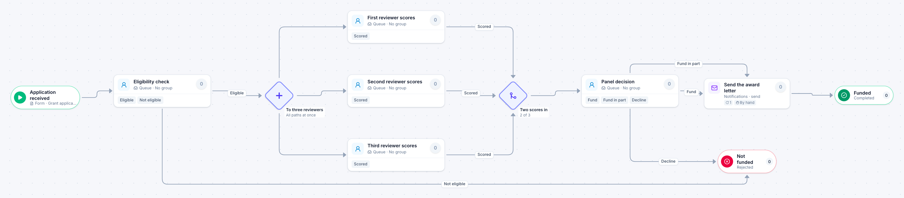

# Grant application review

[Starter templates](../TEMPLATES.md) › Government and public safety

After an eligibility check, three reviewers score the application independently. The panel decides as soon as two scores are in, and funded applicants get an award letter.

8 steps · 5 people steps. Each item is a **Grant application**. Tags: two of three, scoring, grants.

## Steps

| Step | Kind | What it does | Then |
| --- | --- | --- | --- |
| **Application received** | Start | Someone fills in the form. | → Eligibility check |
| **Eligibility check** | Person | A queue: any member of the group claims it. Due in 1 day. | **Eligible** → To three reviewers **Not eligible** (with a comment) → Not funded |
| **To three reviewers** | Parallel split | Starts every path at the same time. | → First reviewer scores → Second reviewer scores → Third reviewer scores |
| **First reviewer scores** | Person | A queue: any member of the group claims it. Due in 7 days. | **Scored** → Two scores in |
| **Second reviewer scores** | Person | A queue: any member of the group claims it. Due in 7 days. | **Scored** → Two scores in |
| **Third reviewer scores** | Person | A queue: any member of the group claims it. Due in 7 days. | **Scored** → Two scores in |
| **Two scores in** | Join | Continues when 2 of 3 branches have arrived. The branches still running are withdrawn. | → Panel decision |
| **Panel decision** | Person | A queue: any member of the group claims it. Due in 1 day. | **Fund** → Send the award letter **Fund in part** → Send the award letter **Decline** (with a comment) → Not funded |
| **Send the award letter** | Automated | Calls the sample service “Notifications”. If the call fails, a person does the step by hand. | → Funded |
| **Not funded** | End | Ends the item as Rejected. |  |
| **Funded** | End | Ends the item as Completed. |  |

## Fields

| Field | Type | Notes |
| --- | --- | --- |
| Applicant | Text | Required · Shown on work cards |
| Amount Requested | Currency | Shown on work cards |
| Application | Attachment |  |
| Average Score | Number |  |

## Use it

In the Studio, open **Templates** and find **Grant application review**. Start a new application from it, or add it to an application you have and map its fields onto yours.

Then make it your own: pick the group that does each people step, change the thresholds and deadlines, publish, and run the simulation to watch work move through it.

---

← [Council agenda item](council-agenda-item.md) · [All templates](../TEMPLATES.md) · [Incident report](incident-report.md) →
