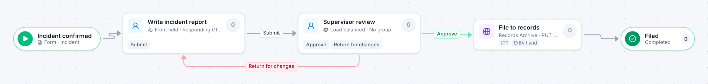

# Incident report

[Starter templates](../TEMPLATES.md) › Government and public safety

The person who handled the incident writes it up (retain familiar), a commander reviews, and it is filed to records automatically.

3 steps · 2 people steps. Each item is an **Incident**. Tags: retain familiar, records.

## Steps

| Step | Kind | What it does | Then |
| --- | --- | --- | --- |
| **Incident confirmed** | Start | Someone fills in the form. | → Write incident report |
| **Write incident report** | Person | Goes to the person named in “Responding Officer”. Due in 8 hours. | **Submit** → Supervisor review |
| **Supervisor review** | Person | Load balanced: each item goes to the member with the fewest open items. Due in 1 day. | **Approve** → File to records **Return for changes** (with a comment) → Write incident report |
| **File to records** | Automated | Calls the sample service “Records Archive”. If the call fails, a person does the step by hand. | → Filed |
| **Filed** | End | Ends the item as Completed. |  |

## Fields

| Field | Type | Notes |
| --- | --- | --- |
| Responding Officer | Person | Set by the process |
| Report | Long text | Set by the process |

## Use it

In the Studio, open **Templates** and find **Incident report**. Start a new application from it, or add it to an application you have and map its fields onto yours.

Then make it your own: pick the group that does each people step, change the thresholds and deadlines, publish, and run the simulation to watch work move through it.

---

← [Grant application review](grant-application-review.md) · [All templates](../TEMPLATES.md) · [Customer complaint](customer-complaint.md) →
