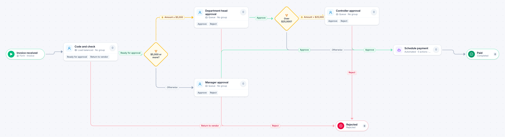

# Invoice approval

[Starter templates](../TEMPLATES.md) › Finance and AP

A clerk codes the invoice, then the amount decides who approves: a manager under $5,000, a department head above that, and the controller as well over $25,000.

7 steps · 4 people steps · 1 step for a system of yours. Each item is an **Invoice**. Tags: accounts payable, threshold, approval.

## Steps

| Step | Kind | What it does | Then |
| --- | --- | --- | --- |
| **Invoice received** | Start | Someone fills in the form. | → Code and check |
| **Code and check** | Person | Load balanced: each item goes to the member with the fewest open items. Due in 1 day. | **Ready for approval** → $5,000 or more? **Return to vendor** (with a comment) → Rejected |
| **$5,000 or more?** | Decision | Checks its rules from the top; the first one that matches wins. | **Amount ≥ $5,000** → Department head approval **Otherwise** → Manager approval |
| **Department head approval** | Person | A queue: any member of the group claims it. Due in 1 day. | **Approve** → Over $25,000? **Reject** (with a comment) → Rejected |
| **Manager approval** | Person | A queue: any member of the group claims it. Due in 1 day. | **Approve** → Schedule payment **Reject** (with a comment) → Rejected |
| **Over $25,000?** | Decision | Checks its rules from the top; the first one that matches wins. | **Amount > $25,000** → Controller approval **Otherwise** → Schedule payment |
| **Controller approval** | Person | A queue: any member of the group claims it. Due in 1 day. Not the person who did “Department head approval”. | **Approve** → Schedule payment **Reject** (with a comment) → Rejected |
| **Rejected** | End | Ends the item as Rejected. |  |
| **Schedule payment** | Automated | **Your system.** A placeholder until you point it at a service of your own; until then it takes its time and passes the item on. | → Paid |
| **Paid** | End | Ends the item as Completed. |  |

## Fields

| Field | Type | Notes |
| --- | --- | --- |
| Vendor | Text | Required · Shown on work cards |
| Amount | Currency | Required · Shown on work cards |
| PO Number | Text |  |
| Approved By | Person | Set by the process |

## Use it

In the Studio, open **Templates** and find **Invoice approval**. Start a new application from it, or add it to an application you have and map its fields onto yours.

Then make it your own: pick the group that does each people step, point the steps marked *your system* at your services, change the thresholds and deadlines, publish, and run the simulation to watch work move through it.

---

[All templates](../TEMPLATES.md) · [Expense report](expense-report.md) →
