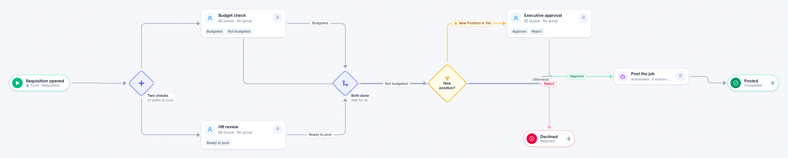

# Job requisition

[Starter templates](../TEMPLATES.md) › People and HR

Finance checks the budget while HR checks the grade and the posting. A replacement can then be posted; a new position needs an executive first.

7 steps · 3 people steps · 1 step for a system of yours. Each item is a **Requisition**. Tags: parallel, recruiting, headcount.

## Steps

| Step | Kind | What it does | Then |
| --- | --- | --- | --- |
| **Requisition opened** | Start | Someone fills in the form. | → Two checks |
| **Two checks** | Parallel split | Starts every path at the same time. | → Budget check → HR review |
| **Budget check** | Person | A queue: any member of the group claims it. Due in 2 days. | **Budgeted** → Both done **Not budgeted** (with a comment) → Declined |
| **HR review** | Person | A queue: any member of the group claims it. Due in 2 days. | **Ready to post** → Both done |
| **Both done** | Join | Waits for every branch. | → New position? |
| **New position?** | Decision | Checks its rules from the top; the first one that matches wins. | **New Position is Yes** → Executive approval **Otherwise** → Post the job |
| **Executive approval** | Person | A queue: any member of the group claims it. Due in 4 days. | **Approve** → Post the job **Reject** (with a comment) → Declined |
| **Declined** | End | Ends the item as Rejected. |  |
| **Post the job** | Automated | **Your system.** A placeholder until you point it at a service of your own; until then it takes its time and passes the item on. | → Posted |
| **Posted** | End | Ends the item as Completed. |  |

## Fields

| Field | Type | Notes |
| --- | --- | --- |
| Job Title | Text | Required · Shown on work cards |
| Department | Text | Shown on work cards |
| Salary Budget | Currency |  |
| New Position | Yes / No |  |

## Use it

In the Studio, open **Templates** and find **Job requisition**. Start a new application from it, or add it to an application you have and map its fields onto yours.

Then make it your own: pick the group that does each people step, point the steps marked *your system* at your services, change the thresholds and deadlines, publish, and run the simulation to watch work move through it.

---

← [Leave of absence](leave-of-absence.md) · [All templates](../TEMPLATES.md) · [Training request](training-request.md) →
