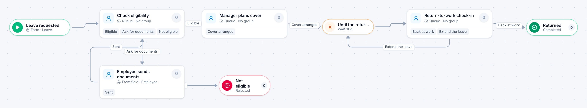

# Leave of absence

[Starter templates](../TEMPLATES.md) › People and HR

HR checks eligibility and can ask the employee for documents. The leave then waits until the return date, when HR either confirms the return or extends it.

5 steps · 4 people steps. Each item is a **Leave**. Tags: timer, return for changes, leave.

## Steps

| Step | Kind | What it does | Then |
| --- | --- | --- | --- |
| **Leave requested** | Start | Someone fills in the form. | → Check eligibility |
| **Check eligibility** | Person | A queue: any member of the group claims it. Due in 3 days. | **Eligible** → Manager plans cover **Ask for documents** (with a comment) → Employee sends documents **Not eligible** (with a comment) → Not eligible |
| **Employee sends documents** | Person | Goes to the person named in “Employee”. Due in 5 days. | **Sent** → Check eligibility |
| **Manager plans cover** | Person | A queue: any member of the group claims it. Due in 1 day. | **Cover arranged** → Until the return date |
| **Not eligible** | End | Ends the item as Rejected. |  |
| **Until the return date** | Timer | Waits 30 days. | → Return-to-work check-in |
| **Return-to-work check-in** | Person | A queue: any member of the group claims it. Due in 1 day. | **Back at work** → Returned **Extend the leave** (with a comment) → Until the return date |
| **Returned** | End | Ends the item as Completed. |  |

## Fields

| Field | Type | Notes |
| --- | --- | --- |
| Employee | Person | Required · Shown on work cards |
| Leave Starts | Date | Required · Shown on work cards |
| Expected Return | Date | Required |
| Supporting Document | Attachment |  |

## Use it

In the Studio, open **Templates** and find **Leave of absence**. Start a new application from it, or add it to an application you have and map its fields onto yours.

Then make it your own: pick the group that does each people step, change the thresholds and deadlines, publish, and run the simulation to watch work move through it.

---

← [Time-off request](time-off-request.md) · [All templates](../TEMPLATES.md) · [Job requisition](job-requisition.md) →
