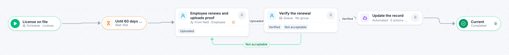

# License and certification renewal

[Starter templates](../TEMPLATES.md) › People and HR

A timer starts the renewal ahead of the expiry date. The employee uploads proof, HR verifies it or sends it back, and it escalates if the date is getting close.

4 steps · 2 people steps · 1 step for a system of yours. Each item is a **License**. Tags: timer, expiry, return for changes.

## Steps

| Step | Kind | What it does | Then |
| --- | --- | --- | --- |
| **License on file** | Start | Items are created on a schedule. | → Until 60 days before it expires |
| **Until 60 days before it expires** | Timer | Waits 30 days. | → Employee renews and uploads proof |
| **Employee renews and uploads proof** | Person | Goes to the person named in “Employee”. Due in 30 days. Escalates after 20 days. | **Uploaded** → Verify the renewal |
| **Verify the renewal** | Person | A queue: any member of the group claims it. Due in 1 day. | **Verified** → Update the record **Not acceptable** (with a comment) → Employee renews and uploads proof |
| **Update the record** | Automated | **Your system.** A placeholder until you point it at a service of your own; until then it takes its time and passes the item on. | → Current |
| **Current** | End | Ends the item as Completed. |  |

## Fields

| Field | Type | Notes |
| --- | --- | --- |
| Employee | Person | Required · Shown on work cards |
| License or Certification | Text | Required · Shown on work cards |
| Expires | Date | Required |
| Proof of Renewal | Attachment |  |

## Use it

In the Studio, open **Templates** and find **License and certification renewal**. Start a new application from it, or add it to an application you have and map its fields onto yours.

Then make it your own: pick the group that does each people step, point the steps marked *your system* at your services, change the thresholds and deadlines, publish, and run the simulation to watch work move through it.

---

← [Training request](training-request.md) · [All templates](../TEMPLATES.md) · [Service desk ticket](service-desk-ticket.md) →
