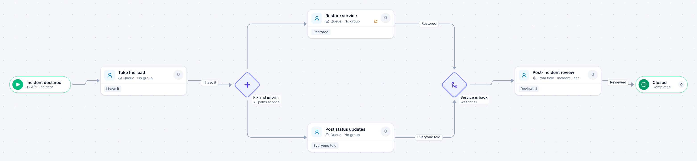

# Major incident

[Starter templates](../TEMPLATES.md) › IT and security

The first on-call engineer to claim it leads. Restoring service and keeping people informed run side by side against a four-hour clock that escalates at two, and a review follows.

6 steps · 4 people steps. Each item is an **Incident**. Tags: claim, parallel, escalation.

## Steps

| Step | Kind | What it does | Then |
| --- | --- | --- | --- |
| **Incident declared** | Start | Another system creates the item through the API. | → Take the lead |
| **Take the lead** | Person | A queue: any member of the group claims it. Due in 1 hour. | **I have it** → Fix and inform |
| **Fix and inform** | Parallel split | Starts every path at the same time. | → Restore service → Post status updates |
| **Restore service** | Person | A queue: any member of the group claims it. Due in 4 hours. Escalates after 2 hours. | **Restored** → Service is back |
| **Post status updates** | Person | A queue: any member of the group claims it. Due in 4 hours. | **Everyone told** → Service is back |
| **Service is back** | Join | Waits for every branch. | → Post-incident review |
| **Post-incident review** | Person | Goes to the person named in “Incident Lead”. Due in 3 days. | **Reviewed** → Closed |
| **Closed** | End | Ends the item as Completed. |  |

## Fields

| Field | Type | Notes |
| --- | --- | --- |
| Service Affected | Text | Required · Shown on work cards |
| Impact | Long text | Required |
| Incident Lead | Person | Set by the process |
| Cause and Fix | Long text |  |

## Use it

In the Studio, open **Templates** and find **Major incident**. Start a new application from it, or add it to an application you have and map its fields onto yours.

Then make it your own: pick the group that does each people step, change the thresholds and deadlines, publish, and run the simulation to watch work move through it.

---

← [Change request](change-request.md) · [All templates](../TEMPLATES.md) · [Quarterly access review](quarterly-access-review.md) →
