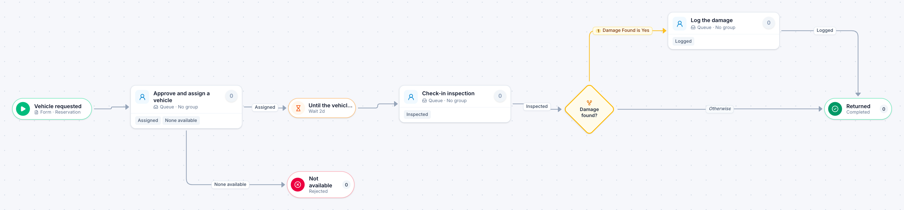

# Motor pool reservation

[Starter templates](../TEMPLATES.md) › Facilities, fleet and safety

The motor pool approves and assigns a vehicle. The reservation then waits until the vehicle is due back, and a check-in inspection logs any damage before it closes.

5 steps · 3 people steps. Each item is a **Reservation**. Tags: timer, reservation, fleet.

## Steps

| Step | Kind | What it does | Then |
| --- | --- | --- | --- |
| **Vehicle requested** | Start | Someone fills in the form. | → Approve and assign a vehicle |
| **Approve and assign a vehicle** | Person | A queue: any member of the group claims it. Due in 1 day. | **Assigned** → Until the vehicle is due back **None available** (with a comment) → Not available |
| **Not available** | End | Ends the item as Rejected. |  |
| **Until the vehicle is due back** | Timer | Waits 2 days. | → Check-in inspection |
| **Check-in inspection** | Person | A queue: any member of the group claims it. Due in 1 day. | **Inspected** → Damage found? |
| **Damage found?** | Decision | Checks its rules from the top; the first one that matches wins. | **Damage Found is Yes** → Log the damage **Otherwise** → Returned |
| **Log the damage** | Person | A queue: any member of the group claims it. Due in 1 day. | **Logged** → Returned |
| **Returned** | End | Ends the item as Completed. |  |

## Fields

| Field | Type | Notes |
| --- | --- | --- |
| Driver | Person | Required · Shown on work cards |
| Pick-up | Date | Required · Shown on work cards |
| Return | Date | Required |
| Purpose | Text |  |
| Damage Found | Yes / No |  |

## Use it

In the Studio, open **Templates** and find **Motor pool reservation**. Start a new application from it, or add it to an application you have and map its fields onto yours.

Then make it your own: pick the group that does each people step, change the thresholds and deadlines, publish, and run the simulation to watch work move through it.

---

← [Vehicle accident report](vehicle-accident-report.md) · [All templates](../TEMPLATES.md) · [Safety near-miss](safety-near-miss.md) →
