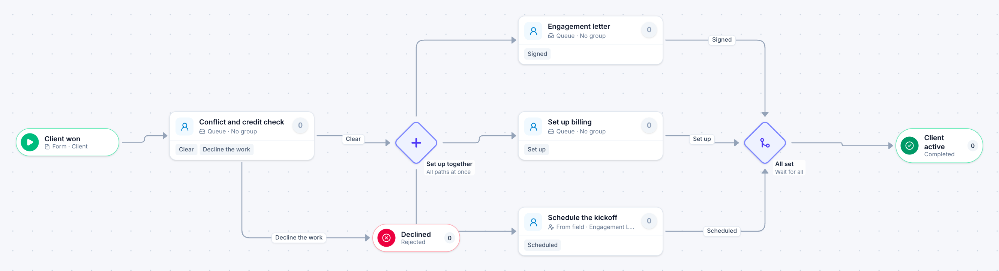

# New client intake

[Starter templates](../TEMPLATES.md) › Customers and operations

A conflict and credit check comes first. Then the engagement letter, billing setup and the kickoff all start together, and the client is active once the three are done.

6 steps · 4 people steps. Each item is a **Client**. Tags: parallel, onboarding, professional services.

## Steps

| Step | Kind | What it does | Then |
| --- | --- | --- | --- |
| **Client won** | Start | Someone fills in the form. | → Conflict and credit check |
| **Conflict and credit check** | Person | A queue: any member of the group claims it. Due in 2 days. | **Clear** → Set up together **Decline the work** (with a comment) → Declined |
| **Declined** | End | Ends the item as Rejected. |  |
| **Set up together** | Parallel split | Starts every path at the same time. | → Engagement letter → Set up billing → Schedule the kickoff |
| **Engagement letter** | Person | A queue: any member of the group claims it. Due in 3 days. | **Signed** → All set |
| **Set up billing** | Person | A queue: any member of the group claims it. Due in 3 days. | **Set up** → All set |
| **Schedule the kickoff** | Person | Goes to the person named in “Engagement Lead”. Due in 3 days. | **Scheduled** → All set |
| **All set** | Join | Waits for every branch. | → Client active |
| **Client active** | End | Ends the item as Completed. |  |

## Fields

| Field | Type | Notes |
| --- | --- | --- |
| Client | Text | Required · Shown on work cards |
| Service | Text | Shown on work cards |
| Estimated Value | Currency |  |
| Engagement Lead | Person | Required |

## Use it

In the Studio, open **Templates** and find **New client intake**. Start a new application from it, or add it to an application you have and map its fields onto yours.

Then make it your own: pick the group that does each people step, change the thresholds and deadlines, publish, and run the simulation to watch work move through it.

---

← [Customer complaint](customer-complaint.md) · [All templates](../TEMPLATES.md) · [Discount approval](discount-approval.md) →
