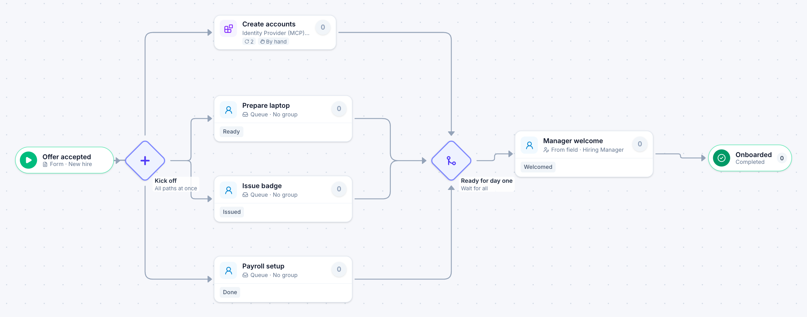

# New hire onboarding

[Starter templates](../TEMPLATES.md) › People and HR

Accounts are created automatically while IT, Facilities and Payroll work in parallel; the hiring manager welcomes the new hire once everything is ready.

7 steps · 4 people steps. Each item is a **New hire**. Tags: parallel, onboarding, MCP.

## Steps

| Step | Kind | What it does | Then |
| --- | --- | --- | --- |
| **Offer accepted** | Start | Someone fills in the form. | → Kick off |
| **Kick off** | Parallel split | Starts every path at the same time. | → Create accounts → Prepare laptop → Issue badge → Payroll setup |
| **Create accounts** | Automated | Calls the sample service “Identity Provider (MCP)”. If the call fails, a person does the step by hand. | → Ready for day one |
| **Prepare laptop** | Person | A queue: any member of the group claims it. Due in 2 days. | → Ready for day one |
| **Issue badge** | Person | A queue: any member of the group claims it. Due in 2 days. | → Ready for day one |
| **Payroll setup** | Person | A queue: any member of the group claims it. Due in 3 days. | → Ready for day one |
| **Ready for day one** | Join | Waits for every branch. | → Manager welcome |
| **Manager welcome** | Person | Goes to the person named in “Hiring Manager”. Due in 1 day. | → Onboarded |
| **Onboarded** | End | Ends the item as Completed. |  |

## Fields

| Field | Type | Notes |
| --- | --- | --- |
| Start Date | Date | Required |
| Hiring Manager | Person | Required |
| Work Email | Email | Set by the process |

## Use it

In the Studio, open **Templates** and find **New hire onboarding**. Start a new application from it, or add it to an application you have and map its fields onto yours.

Then make it your own: pick the group that does each people step, change the thresholds and deadlines, publish, and run the simulation to watch work move through it.

---

← [Contract renewal](contract-renewal.md) · [All templates](../TEMPLATES.md) · [Offboarding](offboarding.md) →
