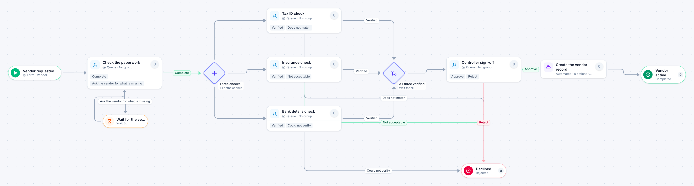

# New vendor setup

[Starter templates](../TEMPLATES.md) › Finance and AP

Accounts payable checks the paperwork and waits for anything missing. Tax, insurance and bank details are then checked at the same time, and the controller signs off before the vendor can be paid.

9 steps · 5 people steps · 1 step for a system of yours. Each item is a **Vendor**. Tags: parallel, return for changes, accounts payable.

## Steps

| Step | Kind | What it does | Then |
| --- | --- | --- | --- |
| **Vendor requested** | Start | Someone fills in the form. | → Check the paperwork |
| **Check the paperwork** | Person | A queue: any member of the group claims it. Due in 1 day. | **Complete** → Three checks **Ask the vendor for what is missing** (with a comment) → Wait for the vendor |
| **Wait for the vendor** | Timer | Waits 3 days. | → Check the paperwork |
| **Three checks** | Parallel split | Starts every path at the same time. | → Tax ID check → Insurance check → Bank details check |
| **Tax ID check** | Person | A queue: any member of the group claims it. Due in 1 day. | **Verified** → All three verified **Does not match** (with a comment) → Declined |
| **Insurance check** | Person | A queue: any member of the group claims it. Due in 1 day. | **Verified** → All three verified **Not acceptable** (with a comment) → Declined |
| **Bank details check** | Person | A queue: any member of the group claims it. Due in 1 day. | **Verified** → All three verified **Could not verify** (with a comment) → Declined |
| **All three verified** | Join | Waits for every branch. | → Controller sign-off |
| **Controller sign-off** | Person | A queue: any member of the group claims it. Due in 1 day. | **Approve** → Create the vendor record **Reject** (with a comment) → Declined |
| **Declined** | End | Ends the item as Rejected. |  |
| **Create the vendor record** | Automated | **Your system.** A placeholder until you point it at a service of your own; until then it takes its time and passes the item on. | → Vendor active |
| **Vendor active** | End | Ends the item as Completed. |  |

## Fields

| Field | Type | Notes |
| --- | --- | --- |
| Vendor Name | Text | Required · Shown on work cards |
| Vendor Contact | Email |  |
| Tax Form | Attachment |  |
| Insurance Certificate | Attachment |  |

## Use it

In the Studio, open **Templates** and find **New vendor setup**. Start a new application from it, or add it to an application you have and map its fields onto yours.

Then make it your own: pick the group that does each people step, point the steps marked *your system* at your services, change the thresholds and deadlines, publish, and run the simulation to watch work move through it.

---

← [Three-way match](three-way-match.md) · [All templates](../TEMPLATES.md) · [Vendor bank change](vendor-bank-change.md) →
