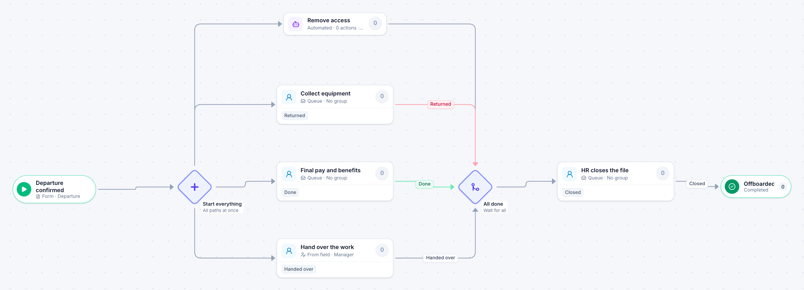

# Offboarding

[Starter templates](../TEMPLATES.md) › People and HR

When someone leaves, access removal, equipment return, final pay and the handover all start at once. HR closes the file only when every one of them is done.

7 steps · 4 people steps · 1 step for a system of yours. Each item is a **Departure**. Tags: parallel, access removal, termination.

## Steps

| Step | Kind | What it does | Then |
| --- | --- | --- | --- |
| **Departure confirmed** | Start | Someone fills in the form. | → Start everything |
| **Start everything** | Parallel split | Starts every path at the same time. | → Remove access → Collect equipment → Final pay and benefits → Hand over the work |
| **Collect equipment** | Person | A queue: any member of the group claims it. Due in 3 days. | **Returned** → All done |
| **Final pay and benefits** | Person | A queue: any member of the group claims it. Due in 3 days. | **Done** → All done |
| **Hand over the work** | Person | Goes to the person named in “Manager”. Due in 4 days. | **Handed over** → All done |
| **Remove access** | Automated | **Your system.** A placeholder until you point it at a service of your own; until then it takes its time and passes the item on. | → All done |
| **All done** | Join | Waits for every branch. | → HR closes the file |
| **HR closes the file** | Person | A queue: any member of the group claims it. Due in 1 day. | **Closed** → Offboarded |
| **Offboarded** | End | Ends the item as Completed. |  |

## Fields

| Field | Type | Notes |
| --- | --- | --- |
| Employee | Person | Required · Shown on work cards |
| Manager | Person | Required |
| Last Day | Date | Required · Shown on work cards |
| Notes | Long text |  |

## Use it

In the Studio, open **Templates** and find **Offboarding**. Start a new application from it, or add it to an application you have and map its fields onto yours.

Then make it your own: pick the group that does each people step, point the steps marked *your system* at your services, change the thresholds and deadlines, publish, and run the simulation to watch work move through it.

---

← [New hire onboarding](new-hire-onboarding.md) · [All templates](../TEMPLATES.md) · [Time-off request](time-off-request.md) →
