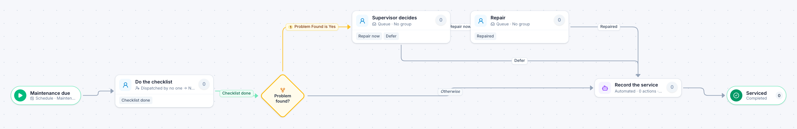

# Preventive maintenance

[Starter templates](../TEMPLATES.md) › Facilities, fleet and safety

A schedule opens the job and a dispatcher hands it to a technician. If the checklist turns up a problem, a supervisor decides whether to repair now or defer it, and the service is recorded either way.

5 steps · 3 people steps · 1 step for a system of yours. Each item is a **Maintenance job**. Tags: schedule, dispatcher, checklist.

## Steps

| Step | Kind | What it does | Then |
| --- | --- | --- | --- |
| **Maintenance due** | Start | Items are created on a schedule. | → Do the checklist |
| **Do the checklist** | Person | A dispatcher hands each item to someone. Due in 3 days. | **Checklist done** → Problem found? |
| **Problem found?** | Decision | Checks its rules from the top; the first one that matches wins. | **Problem Found is Yes** → Supervisor decides **Otherwise** → Record the service |
| **Supervisor decides** | Person | A queue: any member of the group claims it. Due in 1 day. | **Repair now** → Repair **Defer** (with a comment) → Record the service |
| **Repair** | Person | A queue: any member of the group claims it. Due in 2 days. | **Repaired** → Record the service |
| **Record the service** | Automated | **Your system.** A placeholder until you point it at a service of your own; until then it takes its time and passes the item on. | → Serviced |
| **Serviced** | End | Ends the item as Completed. |  |

## Fields

| Field | Type | Notes |
| --- | --- | --- |
| Asset | Text | Required · Shown on work cards |
| Due | Date | Shown on work cards |
| Problem Found | Yes / No |  |
| Findings | Long text |  |

## Use it

In the Studio, open **Templates** and find **Preventive maintenance**. Start a new application from it, or add it to an application you have and map its fields onto yours.

Then make it your own: pick the group that does each people step, point the steps marked *your system* at your services, change the thresholds and deadlines, publish, and run the simulation to watch work move through it.

---

← [Vehicle repair](vehicle-repair.md) · [All templates](../TEMPLATES.md) · [Vehicle accident report](vehicle-accident-report.md) →
