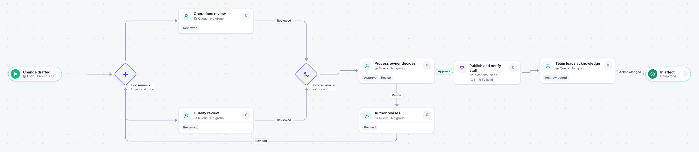

# Procedure change

[Starter templates](../TEMPLATES.md) › Customers and operations

Operations and quality review the draft at the same time. The process owner approves it or sends it back to the author; once approved it is published and team leads acknowledge it.

8 steps · 5 people steps. Each item is a **Procedure change**. Tags: parallel, return for changes, policy.

## Steps

| Step | Kind | What it does | Then |
| --- | --- | --- | --- |
| **Change drafted** | Start | Someone fills in the form. | → Two reviews |
| **Two reviews** | Parallel split | Starts every path at the same time. | → Operations review → Quality review |
| **Operations review** | Person | A queue: any member of the group claims it. Due in 4 days. | **Reviewed** → Both reviews in |
| **Quality review** | Person | A queue: any member of the group claims it. Due in 4 days. | **Reviewed** → Both reviews in |
| **Both reviews in** | Join | Waits for every branch. | → Process owner decides |
| **Process owner decides** | Person | A queue: any member of the group claims it. Due in 1 day. | **Approve** → Publish and notify staff **Revise** (with a comment) → Author revises |
| **Author revises** | Person | A queue: any member of the group claims it. Due in 5 days. | **Revised** → Two reviews |
| **Publish and notify staff** | Automated | Calls the sample service “Notifications”. If the call fails, a person does the step by hand. | → Team leads acknowledge |
| **Team leads acknowledge** | Person | A queue: any member of the group claims it. Due in 5 days. | **Acknowledged** → In effect |
| **In effect** | End | Ends the item as Completed. |  |

## Fields

| Field | Type | Notes |
| --- | --- | --- |
| Procedure | Text | Required · Shown on work cards |
| What Changes | Long text | Required |
| Draft | Attachment |  |
| Review Comments | Long text |  |

## Use it

In the Studio, open **Templates** and find **Procedure change**. Start a new application from it, or add it to an application you have and map its fields onto yours.

Then make it your own: pick the group that does each people step, change the thresholds and deadlines, publish, and run the simulation to watch work move through it.

---

← [Corrective action](corrective-action.md) · [All templates](../TEMPLATES.md) · [Shared inbox triage](shared-inbox-triage.md) →
