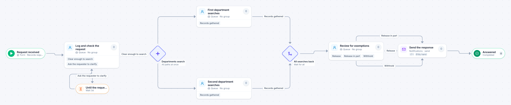

# Public records request

[Starter templates](../TEMPLATES.md) › Government and public safety

The clerk logs the request and can pause it while the requester clarifies. Departments search at the same time, legal reviews for exemptions, and the response goes out. Set the deadline your own law gives you.

8 steps · 4 people steps. Each item is a **Records request**. Tags: deadline, parallel, FOIA.

## Steps

| Step | Kind | What it does | Then |
| --- | --- | --- | --- |
| **Request received** | Start | Someone fills in the form. | → Log and check the request |
| **Log and check the request** | Person | A queue: any member of the group claims it. Due in 1 day. | **Clear enough to search** → Departments search **Ask the requester to clarify** (with a comment) → Until the requester answers |
| **Until the requester answers** | Timer | Waits 3 days. | → Log and check the request |
| **Departments search** | Parallel split | Starts every path at the same time. | → First department searches → Second department searches |
| **First department searches** | Person | A queue: any member of the group claims it. Due in 3 days. | **Records gathered** → All searches back |
| **Second department searches** | Person | A queue: any member of the group claims it. Due in 3 days. | **Records gathered** → All searches back |
| **All searches back** | Join | Waits for every branch. | → Review for exemptions |
| **Review for exemptions** | Person | A queue: any member of the group claims it. Due in 2 days. | **Release** → Send the response **Release in part** (with a comment) → Send the response **Withhold** (with a comment) → Send the response |
| **Send the response** | Automated | Calls the sample service “Notifications”. If the call fails, a person does the step by hand. | → Answered |
| **Answered** | End | Ends the item as Completed. |  |

## Fields

| Field | Type | Notes |
| --- | --- | --- |
| Requester | Text | Required · Shown on work cards |
| Records Requested | Long text | Required |
| Response Due | Date | Shown on work cards |
| Exemption Notes | Long text |  |

## Use it

In the Studio, open **Templates** and find **Public records request**. Start a new application from it, or add it to an application you have and map its fields onto yours.

Then make it your own: pick the group that does each people step, change the thresholds and deadlines, publish, and run the simulation to watch work move through it.

---

← [Alarm screening](alarm-screening.md) · [All templates](../TEMPLATES.md) · [Building permit review](building-permit-review.md) →
