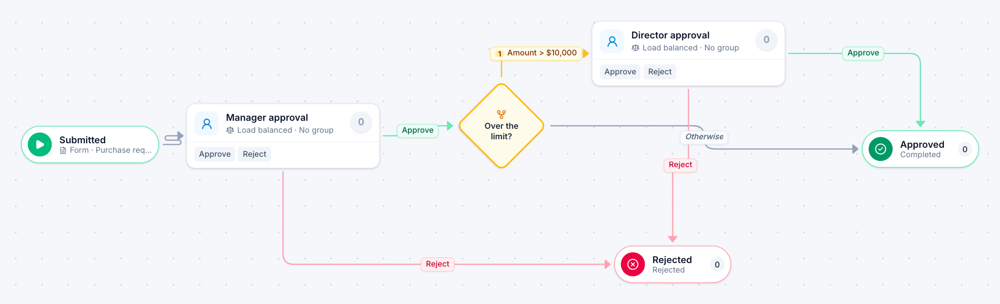

# Purchase request

[Starter templates](../TEMPLATES.md) › Purchasing and contracts

A manager approves the request; anything over $10,000 also needs a director. Ends as Approved or Rejected.

3 steps · 2 people steps. Each item is a **Purchase request**. Tags: threshold, requisition, approval.

## Steps

| Step | Kind | What it does | Then |
| --- | --- | --- | --- |
| **Submitted** | Start | Someone fills in the form. | → Manager approval |
| **Manager approval** | Person | Load balanced: each item goes to the member with the fewest open items. Due in 1 day. | **Approve** → Over the limit? **Reject** (with a comment) → Rejected |
| **Over the limit?** | Decision | Checks its rules from the top; the first one that matches wins. | **Amount > $10,000** → Director approval **Otherwise** → Approved |
| **Director approval** | Person | Load balanced: each item goes to the member with the fewest open items. Due in 1 day. | **Approve** → Approved **Reject** (with a comment) → Rejected |
| **Rejected** | End | Ends the item as Rejected. |  |
| **Approved** | End | Ends the item as Completed. |  |

## Fields

| Field | Type | Notes |
| --- | --- | --- |
| Amount | Currency | Required |
| Approved By | Person | Set by the process |

## Use it

In the Studio, open **Templates** and find **Purchase request**. Start a new application from it, or add it to an application you have and map its fields onto yours.

Then make it your own: pick the group that does each people step, change the thresholds and deadlines, publish, and run the simulation to watch work move through it.

---

← [Capital expenditure request](capital-expenditure-request.md) · [All templates](../TEMPLATES.md) · [Contract review](contract-review.md) →
