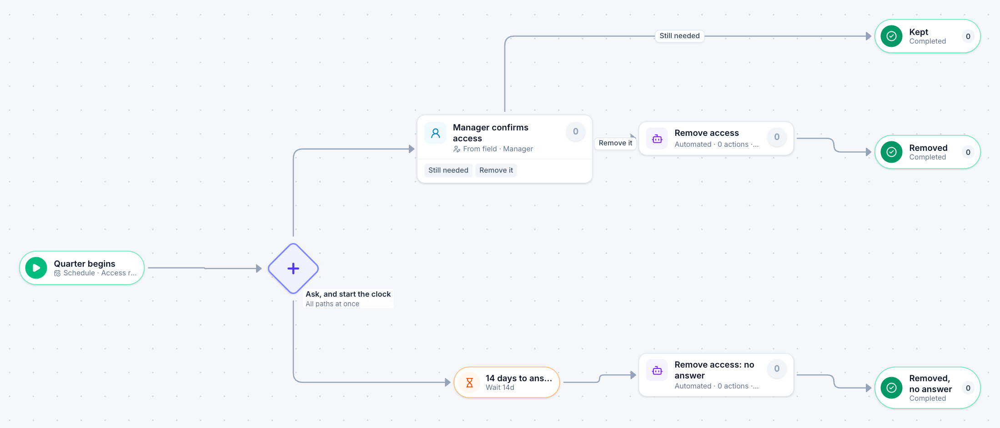

# Quarterly access review

[Starter templates](../TEMPLATES.md) › IT and security

Each manager confirms who still needs access. A 14-day timer runs beside the review: if the manager has not answered when it ends, the access is removed.

5 steps · 1 people step · 2 steps for systems of yours. Each item is an **Access review**. Tags: timer, deadline, audit.

## Steps

| Step | Kind | What it does | Then |
| --- | --- | --- | --- |
| **Quarter begins** | Start | Items are created on a schedule. | → Ask, and start the clock |
| **Ask, and start the clock** | Parallel split | Starts every path at the same time. | → Manager confirms access → 14 days to answer |
| **Manager confirms access** | Person | Goes to the person named in “Manager”. Due in 14 days. | **Still needed** → Kept **Remove it** → Remove access |
| **14 days to answer** | Timer | Waits 14 days. | → Remove access: no answer |
| **Remove access** | Automated | **Your system.** A placeholder until you point it at a service of your own; until then it takes its time and passes the item on. | → Removed |
| **Remove access: no answer** | Automated | **Your system.** A placeholder until you point it at a service of your own; until then it takes its time and passes the item on. | → Removed, no answer |
| **Kept** | End | Ends the item as Completed. |  |
| **Removed** | End | Ends the item as Completed. |  |
| **Removed, no answer** | End | Ends the item as Completed. |  |

## Fields

| Field | Type | Notes |
| --- | --- | --- |
| Account Holder | Person | Required · Shown on work cards |
| Manager | Person | Required |
| System | Text | Required · Shown on work cards |

## Use it

In the Studio, open **Templates** and find **Quarterly access review**. Start a new application from it, or add it to an application you have and map its fields onto yours.

Then make it your own: pick the group that does each people step, point the steps marked *your system* at your services, change the thresholds and deadlines, publish, and run the simulation to watch work move through it.

---

← [Major incident](major-incident.md) · [All templates](../TEMPLATES.md) · [Security incident](security-incident.md) →
