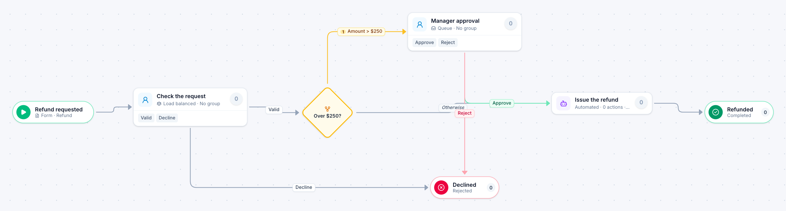

# Refund or credit

[Starter templates](../TEMPLATES.md) › Finance and AP

Customer service checks the request. Refunds of $250 or less are issued straight away; larger ones need a manager first.

4 steps · 2 people steps · 1 step for a system of yours. Each item is a **Refund**. Tags: threshold, customer, credit memo.

## Steps

| Step | Kind | What it does | Then |
| --- | --- | --- | --- |
| **Refund requested** | Start | Someone fills in the form. | → Check the request |
| **Check the request** | Person | Load balanced: each item goes to the member with the fewest open items. Due in 1 day. | **Valid** → Over $250? **Decline** (with a comment) → Declined |
| **Over $250?** | Decision | Checks its rules from the top; the first one that matches wins. | **Amount > $250** → Manager approval **Otherwise** → Issue the refund |
| **Manager approval** | Person | A queue: any member of the group claims it. Due in 1 day. | **Approve** → Issue the refund **Reject** (with a comment) → Declined |
| **Declined** | End | Ends the item as Rejected. |  |
| **Issue the refund** | Automated | **Your system.** A placeholder until you point it at a service of your own; until then it takes its time and passes the item on. | → Refunded |
| **Refunded** | End | Ends the item as Completed. |  |

## Fields

| Field | Type | Notes |
| --- | --- | --- |
| Customer | Text | Required · Shown on work cards |
| Order Number | Text |  |
| Amount | Currency | Required · Shown on work cards |
| Reason | Long text |  |

## Use it

In the Studio, open **Templates** and find **Refund or credit**. Start a new application from it, or add it to an application you have and map its fields onto yours.

Then make it your own: pick the group that does each people step, point the steps marked *your system* at your services, change the thresholds and deadlines, publish, and run the simulation to watch work move through it.

---

← [Check request](check-request.md) · [All templates](../TEMPLATES.md) · [Capital expenditure request](capital-expenditure-request.md) →
