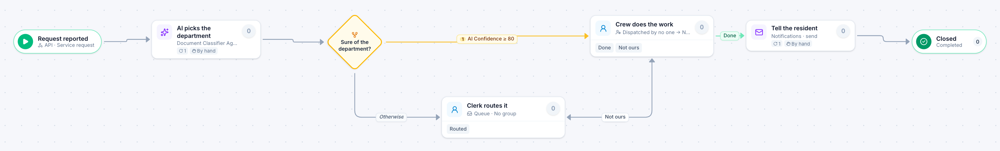

# Resident service request

[Starter templates](../TEMPLATES.md) › Government and public safety

An AI agent picks the department for each request; a clerk routes the ones it is unsure of. A dispatcher hands the job to a crew, and the resident is told when it is done.

5 steps · 2 people steps. Each item is a **Service request**. Tags: AI, dispatcher, 311.

## Steps

| Step | Kind | What it does | Then |
| --- | --- | --- | --- |
| **Request reported** | Start | Another system creates the item through the API. | → AI picks the department |
| **AI picks the department** | Automated | Calls the sample service “Document Classifier Agent”. If the call fails, a person does the step by hand. | → Sure of the department? |
| **Sure of the department?** | Decision | Checks its rules from the top; the first one that matches wins. | **AI Confidence ≥ 80** → Crew does the work **Otherwise** → Clerk routes it |
| **Clerk routes it** | Person | A queue: any member of the group claims it. Due in 1 day. | **Routed** → Crew does the work |
| **Crew does the work** | Person | A dispatcher hands each item to someone. Due in 3 days. | **Done** → Tell the resident **Not ours** (with a comment) → Clerk routes it |
| **Tell the resident** | Automated | Calls the sample service “Notifications”. If the call fails, a person does the step by hand. | → Closed |
| **Closed** | End | Ends the item as Completed. |  |

## Fields

| Field | Type | Notes |
| --- | --- | --- |
| Location | Text | Required · Shown on work cards |
| What Is Wrong | Long text | Required |
| Department | Text | Shown on work cards · Set by the process |
| AI Confidence | Number | Set by the process |

## Use it

In the Studio, open **Templates** and find **Resident service request**. Start a new application from it, or add it to an application you have and map its fields onto yours.

Then make it your own: pick the group that does each people step, change the thresholds and deadlines, publish, and run the simulation to watch work move through it.

---

← [Code enforcement complaint](code-enforcement-complaint.md) · [All templates](../TEMPLATES.md) · [Special event permit](special-event-permit.md) →
