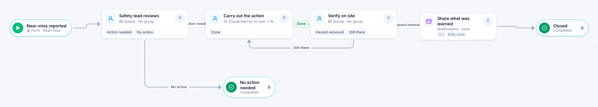

# Safety near-miss

[Starter templates](../TEMPLATES.md) › Facilities, fleet and safety

The first safety lead to pick it up decides whether action is needed. A task is handed out, verified, and sent back if the hazard is still there; then what was learned is shared.

4 steps · 3 people steps. Each item is a **Near-miss**. Tags: claim, verify, safety.

## Steps

| Step | Kind | What it does | Then |
| --- | --- | --- | --- |
| **Near-miss reported** | Start | Someone fills in the form. | → Safety lead reviews |
| **Safety lead reviews** | Person | A queue: any member of the group claims it. Due in 1 day. | **Action needed** → Carry out the action **No action** (with a comment) → No action needed |
| **Carry out the action** | Person | A dispatcher hands each item to someone. Due in 5 days. | **Done** → Verify on site |
| **No action needed** | End | Ends the item as Completed. |  |
| **Verify on site** | Person | A queue: any member of the group claims it. Due in 1 day. Not the person who did “Carry out the action”. | **Hazard removed** → Share what was learned **Still there** (with a comment) → Carry out the action |
| **Share what was learned** | Automated | Calls the sample service “Notifications”. If the call fails, a person does the step by hand. | → Closed |
| **Closed** | End | Ends the item as Completed. |  |

## Fields

| Field | Type | Notes |
| --- | --- | --- |
| Where | Text | Required · Shown on work cards |
| What Nearly Happened | Long text | Required |
| Reported By | Person |  |
| Corrective Action | Long text |  |

## Use it

In the Studio, open **Templates** and find **Safety near-miss**. Start a new application from it, or add it to an application you have and map its fields onto yours.

Then make it your own: pick the group that does each people step, change the thresholds and deadlines, publish, and run the simulation to watch work move through it.

---

← [Motor pool reservation](motor-pool-reservation.md) · [All templates](../TEMPLATES.md) · [Alarm screening](alarm-screening.md) →
