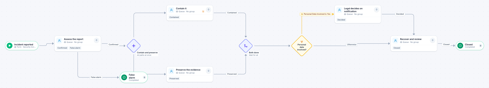

# Security incident

[Starter templates](../TEMPLATES.md) › IT and security

An analyst confirms the report or closes it as a false alarm. Containing it and preserving evidence then run at the same time, and legal is brought in only when personal data is involved.

8 steps · 5 people steps. Each item is a **Security incident**. Tags: parallel, triage, security.

## Steps

| Step | Kind | What it does | Then |
| --- | --- | --- | --- |
| **Incident reported** | Start | Someone fills in the form. | → Assess the report |
| **Assess the report** | Person | A queue: any member of the group claims it. Due in 2 hours. | **Confirmed** → Contain and preserve **False alarm** (with a comment) → False alarm |
| **False alarm** | End | Ends the item as Completed. |  |
| **Contain and preserve** | Parallel split | Starts every path at the same time. | → Contain it → Preserve the evidence |
| **Contain it** | Person | A queue: any member of the group claims it. Due in 4 hours. Escalates after 2 hours. | **Contained** → Both done |
| **Preserve the evidence** | Person | A queue: any member of the group claims it. Due in 8 hours. | **Preserved** → Both done |
| **Both done** | Join | Waits for every branch. | → Personal data involved? |
| **Personal data involved?** | Decision | Checks its rules from the top; the first one that matches wins. | **Personal Data Involved is Yes** → Legal decides on notification **Otherwise** → Recover and review |
| **Legal decides on notification** | Person | A queue: any member of the group claims it. Due in 1 day. | **Decided** → Recover and review |
| **Recover and review** | Person | A queue: any member of the group claims it. Due in 3 days. | **Closed** → Closed |
| **Closed** | End | Ends the item as Completed. |  |

## Fields

| Field | Type | Notes |
| --- | --- | --- |
| What Happened | Text | Required · Shown on work cards |
| Personal Data Involved | Yes / No |  |
| Notes | Long text |  |

## Use it

In the Studio, open **Templates** and find **Security incident**. Start a new application from it, or add it to an application you have and map its fields onto yours.

Then make it your own: pick the group that does each people step, change the thresholds and deadlines, publish, and run the simulation to watch work move through it.

---

← [Quarterly access review](quarterly-access-review.md) · [All templates](../TEMPLATES.md) · [Work order](work-order.md) →
