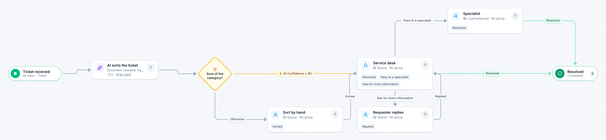

# Service desk ticket

[Starter templates](../TEMPLATES.md) › IT and security

An AI agent sorts each ticket. Sure ones go straight to the service desk queue; the rest are sorted by a person first. The desk resolves it, asks for more information, or passes it to a specialist.

6 steps · 4 people steps. Each item is a **Ticket**. Tags: AI, queue, help desk.

## Steps

| Step | Kind | What it does | Then |
| --- | --- | --- | --- |
| **Ticket received** | Start | Every email that arrives in a mailbox becomes an item. | → AI sorts the ticket |
| **AI sorts the ticket** | Automated | Calls the sample service “Document Classifier Agent”. If the call fails, a person does the step by hand. | → Sure of the category? |
| **Sure of the category?** | Decision | Checks its rules from the top; the first one that matches wins. | **AI Confidence ≥ 80** → Service desk **Otherwise** → Sort by hand |
| **Sort by hand** | Person | A queue: any member of the group claims it. Due in 1 day. | **Sorted** → Service desk |
| **Service desk** | Person | A queue: any member of the group claims it. Due in 8 hours. | **Resolved** → Resolved **Pass to a specialist** → Specialist **Ask for more information** (with a comment) → Requester replies |
| **Requester replies** | Person | A queue: any member of the group claims it. Due in 3 days. | **Replied** → Service desk |
| **Specialist** | Person | Load balanced: each item goes to the member with the fewest open items. Due in 1 day. | **Resolved** → Resolved |
| **Resolved** | End | Ends the item as Completed. |  |

## Fields

| Field | Type | Notes |
| --- | --- | --- |
| Subject | Text | Required · Shown on work cards |
| Details | Long text |  |
| Category | Text | Set by the process |
| AI Confidence | Number | Set by the process |

## Use it

In the Studio, open **Templates** and find **Service desk ticket**. Start a new application from it, or add it to an application you have and map its fields onto yours.

Then make it your own: pick the group that does each people step, change the thresholds and deadlines, publish, and run the simulation to watch work move through it.

---

← [License and certification renewal](license-and-certification-renewal.md) · [All templates](../TEMPLATES.md) · [Access request](access-request.md) →
