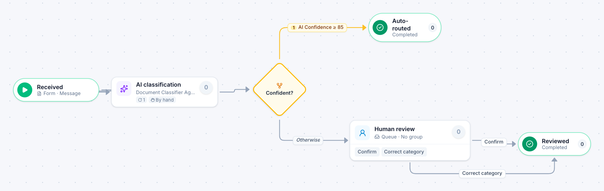

# Shared inbox triage

[Starter templates](../TEMPLATES.md) › Customers and operations

An AI agent classifies each message that arrives. Confident answers go straight through; the rest go to a person, whose corrections are recorded.

3 steps · 1 people step. Each item is a **Message**. Tags: AI, human in the loop, email.

## Steps

| Step | Kind | What it does | Then |
| --- | --- | --- | --- |
| **Received** | Start | Someone fills in the form. | → AI classification |
| **AI classification** | Automated | Calls the sample service “Document Classifier Agent”. If the call fails, a person does the step by hand. | → Confident? |
| **Confident?** | Decision | Checks its rules from the top; the first one that matches wins. | **AI Confidence ≥ 85** → Auto-routed **Otherwise** → Human review |
| **Human review** | Person | A queue: any member of the group claims it. Due in 1 day. | **Confirm** → Reviewed **Correct category** → Reviewed |
| **Auto-routed** | End | Ends the item as Completed. |  |
| **Reviewed** | End | Ends the item as Completed. |  |

## Fields

| Field | Type | Notes |
| --- | --- | --- |
| AI Confidence | Number | Set by the process |
| Category | Text | Set by the process |

## Use it

In the Studio, open **Templates** and find **Shared inbox triage**. Start a new application from it, or add it to an application you have and map its fields onto yours.

Then make it your own: pick the group that does each people step, change the thresholds and deadlines, publish, and run the simulation to watch work move through it.

---

← [Procedure change](procedure-change.md) · [All templates](../TEMPLATES.md)
