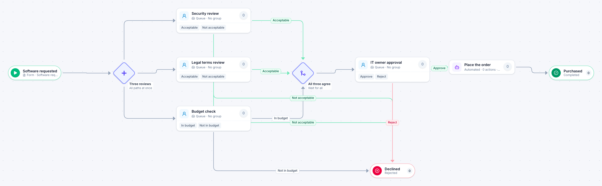

# Software purchase

[Starter templates](../TEMPLATES.md) › Purchasing and contracts

Security, legal and budget look at a new tool at the same time, so the request waits on the slowest of the three and not on all of them in turn. The IT owner approves once all three agree.

7 steps · 4 people steps · 1 step for a system of yours. Each item is a **Software request**. Tags: parallel, security review, software.

## Steps

| Step | Kind | What it does | Then |
| --- | --- | --- | --- |
| **Software requested** | Start | Someone fills in the form. | → Three reviews |
| **Three reviews** | Parallel split | Starts every path at the same time. | → Security review → Legal terms review → Budget check |
| **Security review** | Person | A queue: any member of the group claims it. Due in 4 days. | **Acceptable** → All three agree **Not acceptable** (with a comment) → Declined |
| **Legal terms review** | Person | A queue: any member of the group claims it. Due in 4 days. | **Acceptable** → All three agree **Not acceptable** (with a comment) → Declined |
| **Budget check** | Person | A queue: any member of the group claims it. Due in 2 days. | **In budget** → All three agree **Not in budget** (with a comment) → Declined |
| **All three agree** | Join | Waits for every branch. | → IT owner approval |
| **IT owner approval** | Person | A queue: any member of the group claims it. Due in 1 day. | **Approve** → Place the order **Reject** (with a comment) → Declined |
| **Declined** | End | Ends the item as Rejected. |  |
| **Place the order** | Automated | **Your system.** A placeholder until you point it at a service of your own; until then it takes its time and passes the item on. | → Purchased |
| **Purchased** | End | Ends the item as Completed. |  |

## Fields

| Field | Type | Notes |
| --- | --- | --- |
| Product | Text | Required · Shown on work cards |
| Requested By | Person |  |
| Annual Cost | Currency | Shown on work cards |
| Handles Personal Data | Yes / No |  |

## Use it

In the Studio, open **Templates** and find **Software purchase**. Start a new application from it, or add it to an application you have and map its fields onto yours.

Then make it your own: pick the group that does each people step, point the steps marked *your system* at your services, change the thresholds and deadlines, publish, and run the simulation to watch work move through it.

---

← [Three quotes](three-quotes.md) · [All templates](../TEMPLATES.md) · [Contract renewal](contract-renewal.md) →
