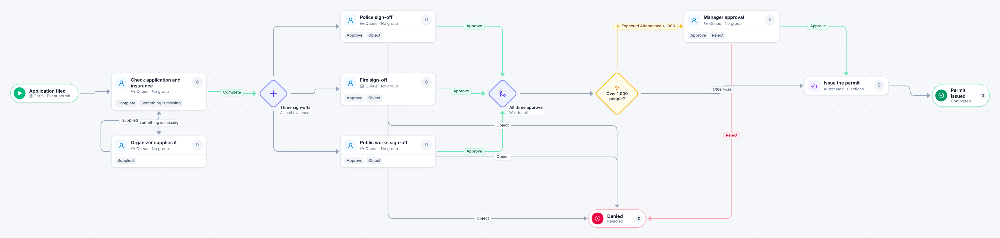

# Special event permit

[Starter templates](../TEMPLATES.md) › Government and public safety

The clerk checks the application and the insurance certificate. Police, fire and public works sign off at the same time, and events expecting more than 1,000 people also need the manager.

10 steps · 6 people steps · 1 step for a system of yours. Each item is an **Event permit**. Tags: parallel, threshold, permits.

## Steps

| Step | Kind | What it does | Then |
| --- | --- | --- | --- |
| **Application filed** | Start | Someone fills in the form. | → Check application and insurance |
| **Check application and insurance** | Person | A queue: any member of the group claims it. Due in 1 day. | **Complete** → Three sign-offs **Something is missing** (with a comment) → Organizer supplies it |
| **Organizer supplies it** | Person | A queue: any member of the group claims it. Due in 7 days. | **Supplied** → Check application and insurance |
| **Three sign-offs** | Parallel split | Starts every path at the same time. | → Police sign-off → Fire sign-off → Public works sign-off |
| **Police sign-off** | Person | A queue: any member of the group claims it. Due in 5 days. | **Approve** → All three approve **Object** (with a comment) → Denied |
| **Fire sign-off** | Person | A queue: any member of the group claims it. Due in 5 days. | **Approve** → All three approve **Object** (with a comment) → Denied |
| **Public works sign-off** | Person | A queue: any member of the group claims it. Due in 5 days. | **Approve** → All three approve **Object** (with a comment) → Denied |
| **All three approve** | Join | Waits for every branch. | → Over 1,000 people? |
| **Denied** | End | Ends the item as Rejected. |  |
| **Over 1,000 people?** | Decision | Checks its rules from the top; the first one that matches wins. | **Expected Attendance > 1000** → Manager approval **Otherwise** → Issue the permit |
| **Manager approval** | Person | A queue: any member of the group claims it. Due in 3 days. | **Approve** → Issue the permit **Reject** (with a comment) → Denied |
| **Issue the permit** | Automated | **Your system.** A placeholder until you point it at a service of your own; until then it takes its time and passes the item on. | → Permit issued |
| **Permit issued** | End | Ends the item as Completed. |  |

## Fields

| Field | Type | Notes |
| --- | --- | --- |
| Event | Text | Required · Shown on work cards |
| Event Date | Date | Required · Shown on work cards |
| Expected Attendance | Number |  |
| Insurance Certificate | Attachment |  |

## Use it

In the Studio, open **Templates** and find **Special event permit**. Start a new application from it, or add it to an application you have and map its fields onto yours.

Then make it your own: pick the group that does each people step, point the steps marked *your system* at your services, change the thresholds and deadlines, publish, and run the simulation to watch work move through it.

---

← [Resident service request](resident-service-request.md) · [All templates](../TEMPLATES.md) · [Council agenda item](council-agenda-item.md) →
