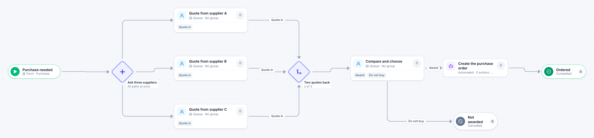

# Three quotes

[Starter templates](../TEMPLATES.md) › Purchasing and contracts

Three suppliers are asked for a quote at the same time. The buyer compares as soon as two have answered, and the third is no longer waited for.

7 steps · 4 people steps · 1 step for a system of yours. Each item is a **Purchase**. Tags: two of three, competitive quotes, purchasing.

## Steps

| Step | Kind | What it does | Then |
| --- | --- | --- | --- |
| **Purchase needed** | Start | Someone fills in the form. | → Ask three suppliers |
| **Ask three suppliers** | Parallel split | Starts every path at the same time. | → Quote from supplier A → Quote from supplier B → Quote from supplier C |
| **Quote from supplier A** | Person | A queue: any member of the group claims it. Due in 4 days. | **Quote in** → Two quotes back |
| **Quote from supplier B** | Person | A queue: any member of the group claims it. Due in 4 days. | **Quote in** → Two quotes back |
| **Quote from supplier C** | Person | A queue: any member of the group claims it. Due in 4 days. | **Quote in** → Two quotes back |
| **Two quotes back** | Join | Continues when 2 of 3 branches have arrived. The branches still running are withdrawn. | → Compare and choose |
| **Compare and choose** | Person | A queue: any member of the group claims it. Due in 1 day. | **Award** → Create the purchase order **Do not buy** (with a comment) → Not awarded |
| **Create the purchase order** | Automated | **Your system.** A placeholder until you point it at a service of your own; until then it takes its time and passes the item on. | → Ordered |
| **Not awarded** | End | Ends the item as Cancelled. |  |
| **Ordered** | End | Ends the item as Completed. |  |

## Fields

| Field | Type | Notes |
| --- | --- | --- |
| What Is Needed | Text | Required · Shown on work cards |
| Estimated Cost | Currency | Shown on work cards |
| Chosen Quote | Currency |  |
| Chosen Supplier | Text |  |

## Use it

In the Studio, open **Templates** and find **Three quotes**. Start a new application from it, or add it to an application you have and map its fields onto yours.

Then make it your own: pick the group that does each people step, point the steps marked *your system* at your services, change the thresholds and deadlines, publish, and run the simulation to watch work move through it.

---

← [Contract review](contract-review.md) · [All templates](../TEMPLATES.md) · [Software purchase](software-purchase.md) →
