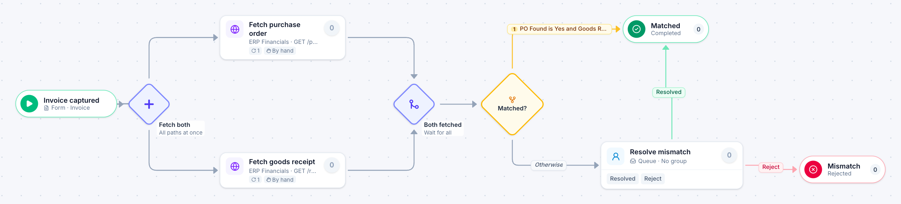

# Three-way match

[Starter templates](../TEMPLATES.md) › Finance and AP

Fetch the purchase order and the goods receipt in parallel, then match them against the invoice. Only mismatches go to a person. The two fetch steps call the sample ERP: point them at your own purchasing system.

6 steps · 1 people step. Each item is an **Invoice**. Tags: parallel, accounts payable, ERP.

## Steps

| Step | Kind | What it does | Then |
| --- | --- | --- | --- |
| **Invoice captured** | Start | Someone fills in the form. | → Fetch both |
| **Fetch both** | Parallel split | Starts every path at the same time. | → Fetch purchase order → Fetch goods receipt |
| **Fetch purchase order** | Automated | Calls the sample service “ERP Financials”. If the call fails, a person does the step by hand. | → Both fetched |
| **Fetch goods receipt** | Automated | Calls the sample service “ERP Financials”. If the call fails, a person does the step by hand. | → Both fetched |
| **Both fetched** | Join | Waits for every branch. | → Matched? |
| **Matched?** | Decision | Checks its rules from the top; the first one that matches wins. | **PO Found is Yes and Goods Received is Yes** → Matched **Otherwise** → Resolve mismatch |
| **Resolve mismatch** | Person | A queue: any member of the group claims it. Due in 1 day. | **Resolved** → Matched **Reject** (with a comment) → Mismatch |
| **Matched** | End | Ends the item as Completed. |  |
| **Mismatch** | End | Ends the item as Rejected. |  |

## Fields

| Field | Type | Notes |
| --- | --- | --- |
| PO Number | Text |  |
| PO Found | Yes / No | Set by the process |
| Goods Received | Yes / No | Set by the process |

## Use it

In the Studio, open **Templates** and find **Three-way match**. Start a new application from it, or add it to an application you have and map its fields onto yours.

Then make it your own: pick the group that does each people step, change the thresholds and deadlines, publish, and run the simulation to watch work move through it.

---

← [Travel request](travel-request.md) · [All templates](../TEMPLATES.md) · [New vendor setup](new-vendor-setup.md) →
