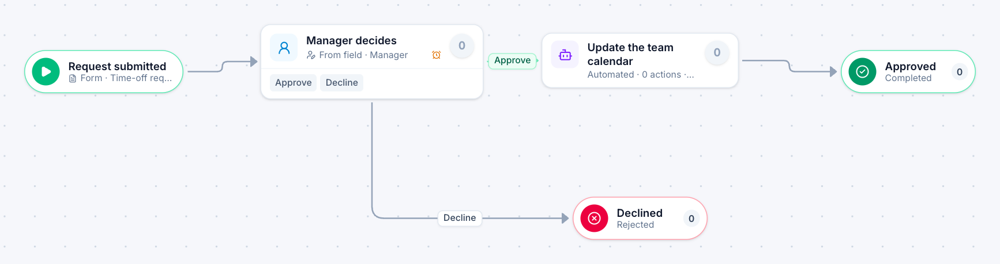

# Time-off request

[Starter templates](../TEMPLATES.md) › People and HR

The request goes to the employee’s own manager. If nobody has answered in 48 hours it is escalated; once approved, the team calendar is updated.

2 steps · 1 people step · 1 step for a system of yours. Each item is a **Time-off request**. Tags: PTO, vacation, escalation.

## Steps

| Step | Kind | What it does | Then |
| --- | --- | --- | --- |
| **Request submitted** | Start | Someone fills in the form. | → Manager decides |
| **Manager decides** | Person | Goes to the person named in “Manager”. Due in 2 days. Escalates after 2 days. | **Approve** → Update the team calendar **Decline** (with a comment) → Declined |
| **Update the team calendar** | Automated | **Your system.** A placeholder until you point it at a service of your own; until then it takes its time and passes the item on. | → Approved |
| **Declined** | End | Ends the item as Rejected. |  |
| **Approved** | End | Ends the item as Completed. |  |

## Fields

| Field | Type | Notes |
| --- | --- | --- |
| Employee | Person | Required · Shown on work cards |
| Manager | Person | Required |
| First Day Off | Date | Required · Shown on work cards |
| Last Day Off | Date | Required |
| Working Days | Number |  |

## Use it

In the Studio, open **Templates** and find **Time-off request**. Start a new application from it, or add it to an application you have and map its fields onto yours.

Then make it your own: pick the group that does each people step, point the steps marked *your system* at your services, change the thresholds and deadlines, publish, and run the simulation to watch work move through it.

---

← [Offboarding](offboarding.md) · [All templates](../TEMPLATES.md) · [Leave of absence](leave-of-absence.md) →
