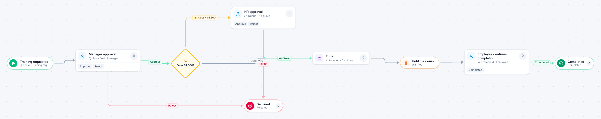

# Training request

[Starter templates](../TEMPLATES.md) › People and HR

The employee’s manager approves; courses over $1,500 also go to HR. After the course the employee confirms they finished it, so the record is complete.

6 steps · 3 people steps · 1 step for a system of yours. Each item is a **Training request**. Tags: threshold, timer, development.

## Steps

| Step | Kind | What it does | Then |
| --- | --- | --- | --- |
| **Training requested** | Start | Someone fills in the form. | → Manager approval |
| **Manager approval** | Person | Goes to the person named in “Manager”. Due in 3 days. | **Approve** → Over $1,500? **Reject** (with a comment) → Declined |
| **Over $1,500?** | Decision | Checks its rules from the top; the first one that matches wins. | **Cost > $1,500** → HR approval **Otherwise** → Enroll |
| **HR approval** | Person | A queue: any member of the group claims it. Due in 1 day. | **Approve** → Enroll **Reject** (with a comment) → Declined |
| **Declined** | End | Ends the item as Rejected. |  |
| **Enroll** | Automated | **Your system.** A placeholder until you point it at a service of your own; until then it takes its time and passes the item on. | → Until the course ends |
| **Until the course ends** | Timer | Waits 10 days. | → Employee confirms completion |
| **Employee confirms completion** | Person | Goes to the person named in “Employee”. Due in 1 day. | **Completed** → Completed |
| **Completed** | End | Ends the item as Completed. |  |

## Fields

| Field | Type | Notes |
| --- | --- | --- |
| Employee | Person | Required · Shown on work cards |
| Manager | Person | Required |
| Course | Text | Required · Shown on work cards |
| Cost | Currency |  |
| Certificate | Attachment |  |

## Use it

In the Studio, open **Templates** and find **Training request**. Start a new application from it, or add it to an application you have and map its fields onto yours.

Then make it your own: pick the group that does each people step, point the steps marked *your system* at your services, change the thresholds and deadlines, publish, and run the simulation to watch work move through it.

---

← [Job requisition](job-requisition.md) · [All templates](../TEMPLATES.md) · [License and certification renewal](license-and-certification-renewal.md) →
