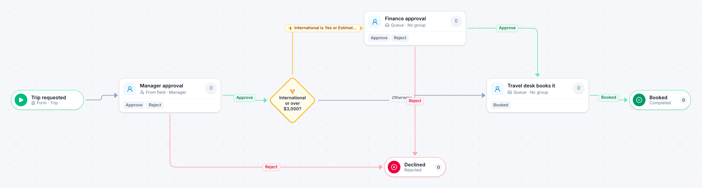

# Travel request

[Starter templates](../TEMPLATES.md) › Finance and AP

The traveler’s manager approves. International trips and trips over $3,000 also go to finance before the travel desk books anything.

4 steps · 3 people steps. Each item is a **Trip**. Tags: threshold, travel, approval.

## Steps

| Step | Kind | What it does | Then |
| --- | --- | --- | --- |
| **Trip requested** | Start | Someone fills in the form. | → Manager approval |
| **Manager approval** | Person | Goes to the person named in “Manager”. Due in 2 days. | **Approve** → International or over $3,000? **Reject** (with a comment) → Declined |
| **International or over $3,000?** | Decision | Checks its rules from the top; the first one that matches wins. | **International is Yes or Estimated Cost > $3,000** → Finance approval **Otherwise** → Travel desk books it |
| **Finance approval** | Person | A queue: any member of the group claims it. Due in 2 days. | **Approve** → Travel desk books it **Reject** (with a comment) → Declined |
| **Declined** | End | Ends the item as Rejected. |  |
| **Travel desk books it** | Person | A queue: any member of the group claims it. Due in 2 days. | **Booked** → Booked |
| **Booked** | End | Ends the item as Completed. |  |

## Fields

| Field | Type | Notes |
| --- | --- | --- |
| Traveler | Person | Required · Shown on work cards |
| Manager | Person | Required |
| Destination | Text | Required · Shown on work cards |
| Departure | Date | Required |
| Estimated Cost | Currency |  |
| International | Yes / No |  |

## Use it

In the Studio, open **Templates** and find **Travel request**. Start a new application from it, or add it to an application you have and map its fields onto yours.

Then make it your own: pick the group that does each people step, change the thresholds and deadlines, publish, and run the simulation to watch work move through it.

---

← [Expense report](expense-report.md) · [All templates](../TEMPLATES.md) · [Three-way match](three-way-match.md) →
