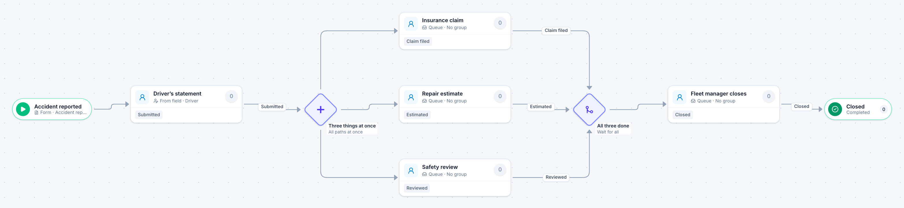

# Vehicle accident report

[Starter templates](../TEMPLATES.md) › Facilities, fleet and safety

The driver named on the report writes the statement. The insurance claim, the repair estimate and the safety review then run at the same time before the fleet manager closes it.

7 steps · 5 people steps. Each item is an **Accident report**. Tags: parallel, person on the item, fleet.

## Steps

| Step | Kind | What it does | Then |
| --- | --- | --- | --- |
| **Accident reported** | Start | Someone fills in the form. | → Driver’s statement |
| **Driver’s statement** | Person | Goes to the person named in “Driver”. Due in 1 day. | **Submitted** → Three things at once |
| **Three things at once** | Parallel split | Starts every path at the same time. | → Insurance claim → Repair estimate → Safety review |
| **Insurance claim** | Person | A queue: any member of the group claims it. Due in 3 days. | **Claim filed** → All three done |
| **Repair estimate** | Person | A queue: any member of the group claims it. Due in 3 days. | **Estimated** → All three done |
| **Safety review** | Person | A queue: any member of the group claims it. Due in 4 days. | **Reviewed** → All three done |
| **All three done** | Join | Waits for every branch. | → Fleet manager closes |
| **Fleet manager closes** | Person | A queue: any member of the group claims it. Due in 1 day. | **Closed** → Closed |
| **Closed** | End | Ends the item as Completed. |  |

## Fields

| Field | Type | Notes |
| --- | --- | --- |
| Driver | Person | Required · Shown on work cards |
| Vehicle | Text | Required · Shown on work cards |
| Date of Accident | Date | Required |
| What Happened | Long text |  |
| Anyone Injured | Yes / No |  |

## Use it

In the Studio, open **Templates** and find **Vehicle accident report**. Start a new application from it, or add it to an application you have and map its fields onto yours.

Then make it your own: pick the group that does each people step, change the thresholds and deadlines, publish, and run the simulation to watch work move through it.

---

← [Preventive maintenance](preventive-maintenance.md) · [All templates](../TEMPLATES.md) · [Motor pool reservation](motor-pool-reservation.md) →
