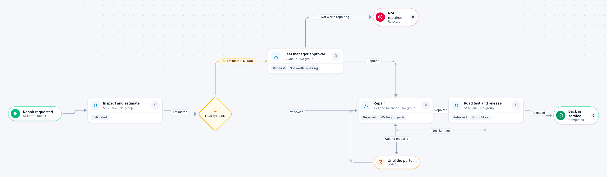

# Vehicle repair

[Starter templates](../TEMPLATES.md) › Facilities, fleet and safety

A mechanic inspects and estimates. Repairs over $1,500 need the fleet manager, who can decide the vehicle is not worth repairing. A road test releases it back into service.

6 steps · 4 people steps. Each item is a **Repair**. Tags: threshold, fleet, waiting on parts.

## Steps

| Step | Kind | What it does | Then |
| --- | --- | --- | --- |
| **Repair requested** | Start | Someone fills in the form. | → Inspect and estimate |
| **Inspect and estimate** | Person | A queue: any member of the group claims it. Due in 1 day. | **Estimated** → Over $1,500? |
| **Over $1,500?** | Decision | Checks its rules from the top; the first one that matches wins. | **Estimate > $1,500** → Fleet manager approval **Otherwise** → Repair |
| **Fleet manager approval** | Person | A queue: any member of the group claims it. Due in 1 day. | **Repair it** → Repair **Not worth repairing** (with a comment) → Not repaired |
| **Repair** | Person | Load balanced: each item goes to the member with the fewest open items. Due in 3 days. | **Repaired** → Road test and release **Waiting on parts** → Until the parts arrive |
| **Not repaired** | End | Ends the item as Rejected. |  |
| **Until the parts arrive** | Timer | Waits 2 days. | → Repair |
| **Road test and release** | Person | A queue: any member of the group claims it. Due in 1 day. | **Released** → Back in service **Not right yet** (with a comment) → Repair |
| **Back in service** | End | Ends the item as Completed. |  |

## Fields

| Field | Type | Notes |
| --- | --- | --- |
| Vehicle | Text | Required · Shown on work cards |
| Problem | Long text | Required |
| Estimate | Currency | Shown on work cards |

## Use it

In the Studio, open **Templates** and find **Vehicle repair**. Start a new application from it, or add it to an application you have and map its fields onto yours.

Then make it your own: pick the group that does each people step, change the thresholds and deadlines, publish, and run the simulation to watch work move through it.

---

← [Work order](work-order.md) · [All templates](../TEMPLATES.md) · [Preventive maintenance](preventive-maintenance.md) →
